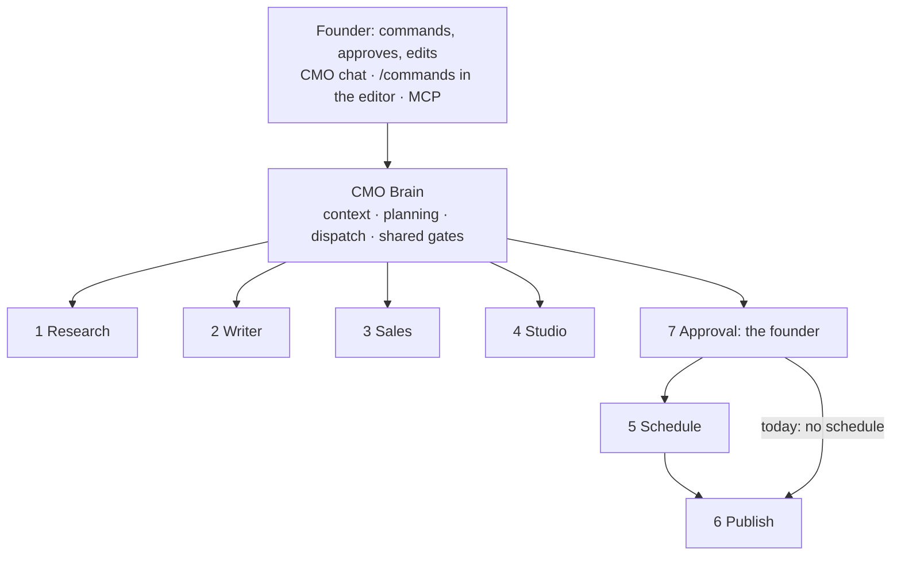

# The CMO brain and its departments

Status: **proposed** (2026-10-25). Markdown twin of [`ai-cmo.html`](ai-cmo.html), written for agents; the two
must say the same thing. Replaces the PR #117 diagram page and `docs/cmo-architecture-implementation.md`.
[`ARCHITECTURE.md`](../../ARCHITECTURE.md) §11 still describes the CMO as built today.

OpenCMO is one CMO brain that plans and dispatches work to seven departments, with the founder approving
everything that goes out. The departments are the product, so the system is shaped around them, not the other way
round. It stays one system: Vercel + Supabase + Modal.

## 1. The brain and seven departments

State of the code on 2026-10-25: ✅ built · 🟡 partial · ❌ missing.

| Part | Capabilities |
|---|---|
| Brain | ✅ context (documents, Brand Kit, memories, lessons) · ✅ planning (`plan_week`, `review_week`, `cmo_goals`) · 🟡 dispatch (`cmo_runs`) · 🟡 shared gates (credit, moderation, approval, limits) |
| 1 Research | ✅ competitors, outlier posts · ✅ Reddit, X, short video · ✅ metrics after posting |
| 2 Writer | ✅ X posts · 🟡 per-platform caption + tags · 🟡 script + storyboard (`director`) · ❌ article · ❌ No AI Slop |
| 3 Sales | ✅ find Reddit threads · ✅ scored with evidence · ✅ reply drafts, the founder posts |
| 4 Studio | ✅ edit your own video · ✅ `/video` `/image` `/animate` `/broll` `/voiceover` `/music` · ✅ `render_document` → MP4 · ❌ slideshow · ❌ clips from a finished edit |
| 5 Schedule (new) | 🟡 day in the week plan · ❌ approved time · ❌ reminders, publish trigger |
| 6 Publish | ✅ X intent link · ❌ Threads, LinkedIn intent · ❌ TikTok, IG, YouTube (Zernio) |
| 7 Approval | ✅ X posts, Reddit replies · ❌ script before the build · ❌ finished videos · ❌ time + account |

## 2. How work flows

Three lanes share the departments. Columns: Brain → Research → Writer → Approval ① → Studio → Approval ② →
Schedule → Publish → Insight (metrics). *new* marks a step that does not exist yet.

| Lane | Steps |
|---|---|
| Video · slideshow · clip | week order (`plan_week`) → idea (outliers, competitors) → script + storyboard *new* → approve script *new* → build + render (Assistant, worker) → approve video *new* → time slot *new* → post *new* → metrics (`pull_metrics`) |
| Post · caption · article | week order → angle (research) → draft (`post_draft`) → approve post → time slot *new* → post (founder taps intent) → metrics (`post_metrics`). Today approve → post directly. |
| Sales | scan order (`sales_scan`) → Reddit thread (ScrapeCreators) → reply draft (sales + checker) → approve (`opportunities`) → founder replies by hand (no post button) → outcome (`replied`) |

Loop: metrics, the founder's edits and winning posts → `cmo_memories` + `cmo_lessons` → next week's plan.
Send-back loops: approve script → Writer; approve video → Studio.

## 3. Target system: built around the departments

Four layers. Every capability is marked by the build-or-buy decision in §7: **own** (built), **own-new** (to
build), **buy**.

1. **Founder** — entry points: app + approval inbox, editor + Assistant, CMO chat, MCP from Claude.
2. **Brain** — planning (own) · dispatch: `work_orders` tree, `depends_on`, budget (own-new) · memory (own) ·
   capability registry: one tool list for brain, UI, Assistant, MCP (own-new) · event rules: status change → next
   order (own-new).
3. **Departments**
   - Research: `competitor_research`, outlier + social, `pull_metrics` (own) · ScrapeCreators (buy)
   - Writer: post + caption (own) · article, script + storyboard, No AI Slop (own-new) · LLM registry (buy)
   - Sales: `sales_scan`, score + draft (own) · ScrapeCreators (buy)
   - Studio: `editor-core` ops, `render_document` (own) · slideshow, `clip_from_edit`, headless `build_video`
     (own-new) · fal.ai, ElevenLabs (buy)
   - Approval: checker scores first (own) · one inbox, approval snapshot, in-app + push notices (own-new) · email
     via Resend (buy)
   - Schedule: calendar + slots, best time from data, reminders (own-new) · clock = Modal `sweep` (own)
   - Publish: intent link (own) · one adapter, `social_accounts` (own-new) · X API pay-per-use, Zernio (buy)
4. **Data spine (Supabase)** — new: `work_orders`, `deliverables`, `approvals`, `schedule_slots`,
   `social_accounts` (Zernio ids, no tokens); existing: `editor_projects`, `tasks`, `credit_ledger`, Storage.
   Every write goes through a gated RPC (ownership, credit hold, limits).
5. **Runtime (still one system)** — Vercel: web, approval inbox, brain, Research, Writer, Sales · Modal worker:
   heavy Studio work, `publish_post`, the clock · Modal MCP app: own secret, user JWT · bought: LLMs, fal,
   ElevenLabs, ScrapeCreators, Resend, X, Zernio.

## 4. System today, by its real call paths

Container view of `main` (`eb858ca`).

| Container | Holds |
|---|---|
| Vercel `apps/web` | UI (editor, approval, Brand Kit) · API v1 (reads under RLS, writes via owner RPCs) · CMO engine `lib/cmo` (12 agents, skills, runner of `cmo_runs`) · Assistant `lib/agent` + Generate `lib/generate` · Polar webhook, `/api/cron/*`, `/api/internal/cmo/run`. Service role: webhooks, cron, CMO runner only. |
| Supabase | Auth (Google OAuth, email) · Postgres: queues `tasks`, `cmo_runs`; CMO `marketing_documents`, `content_items`, `opportunities`, `post_metrics`, `cmo_memories`; editor `editor_projects`, `media_assets`, `generations`, `brand_kits`, `scene_codes`; money and limits `credit_ledger`, `polar_*`, `operation_log`, `rate_limits`, `api_keys`, `mcp_grants` · Storage: `sources`, `media`, `exports`, `clips`, `brand` |
| Modal `opencmo-mcp` | `packages/mcp-server`, always warm, API key → 5-minute user JWT, paid plans only, wakes the worker; no worker secrets |
| Modal `opencmo` worker | `submit` → `run_task`; `sweep` every minute; `cmo_schedule` 00:05, `cleanup` 03:00; task kinds `probe_media`, `transcribe_media`, `transcribe_asset`, `generate`, `render_document`, `capture_page`; `look`, `render_three` (GPU), `render_motion`; `moderation.py`; peak RAM < 2 GB; holds the service role |
| Bought | LLM (Anthropic, Gemini, Groq, OpenAI-compatible; called by Vercel, worker, MCP) · fal.ai + NSFW classifier, ElevenLabs voice + Scribe (Vercel, worker) · ScrapeCreators (Vercel) · Polar, Sentry, GitHub CI, Google OAuth |

Edges:

1. Browser → Vercel: HTTPS, session cookie, reads under RLS.
2. Browser → Storage: TUS upload with a reservation; downloads by signed URL. Files never pass through Next.js.
3. Vercel → Postgres: owner-checking RPCs; credit hold and work creation in one transaction.
4. Vercel → Modal `submit` on click; `sweep` claims within a minute if it fails.
5. Worker ↔ Postgres + Storage: lease claims, results, files (service role).
6. Modal → Vercel: the only clock (`cmo_schedule`, `cmo_runs` dispatch, `cleanup`).
7. Founder's Claude → MCP with an API key.
8. MCP → Postgres under RLS with a user JWT; MCP → worker `wake`.
9. Browser → platform: intent link, the founder taps post.
10. Polar → Vercel webhook, with a receipts table.
11. *Proposed*: worker `publish_post` → Zernio → platforms at the approved time.

What the PR #117 system diagram got wrong: stacked one-way boxes hid paths 2, 4, 6 and 9; MCP is its own Modal app
(`packages/engine/mcp_app.py`; `apps/web/app/api/mcp` answers 410); Modal only keeps time, CMO jobs run on Vercel;
moderation is the `moderation` agent in `CMO_LLM_PROVIDERS` order + fal NSFW, not Gemini; Supabase had no queues
or tables and put plans and drafts in Storage; clipping and "Writer → script → Assistant" were drawn as running.

## 5. Content lifecycle

`content_items_status_check`: `planned → drafting → in_review → approved → published` (+ `skipped`, `failed`). The
only new state is `scheduled`.

| Lane | Steps (*new* = proposed) |
|---|---|
| X post, Reddit | `planned` (plan-week, Vercel) → `drafting` (writer + checker, Vercel) → `in_review` (founder, Supabase) → `approved` (≤ 5 a day) → `scheduled` *new* (worker → Zernio) → `published` (founder taps intent) → `post_metrics`. Today `approved → published` directly. |
| Video | `planned` → `script` *new* (director) → `in_review` script *new* → `editing` (Assistant, editor) → `render` (`render_document`, worker) → `in_review` video *new* → `approved` *new* (Post + video, then continues like a post) → `clips` *new* (cut from the edit, worker). Today `planned` opens the upload tab. |

## 6. Nine system changes

No Inngest, Trigger.dev or Temporal: the Postgres queues and the Modal clock already run, CLAUDE.md forbids a
second runtime, and the editor roadmap lists a Temporal-style engine under "Not now".

| # | Change | Serves | Size |
|---|---|---|---|
| 1 | `work_orders` replaces `cmo_runs`: + department, `parent_id`, `depends_on`, credit budget; a week order spawns a tree | Brain | M |
| 2 | `deliverables` replaces `content_items`: + `kind` (post, caption, article, script, video, slideshow, clip, image, reply), `parent_id`, `editor_project_id`, `account_id` | All | M |
| 3 | One capability registry in `packages/contracts` (like `task-kinds.json`), CMO and editor tools under their department; `check:contracts` fails on drift | Brain, MCP | M |
| 4 | Headless Studio: `build_video` order runs an Assistant session in steps via `cmo_defer_run`, holds credits per order, stops at Approval | Studio | L |
| 5 | Event rules in Postgres: approved → Schedule; due → Publish; +24 h → Research | All | M |
| 6 | One approval inbox: `approvals` snapshot (content hash, time, account); in-app + web push (own), email (Resend) | Approval | M |
| 7 | `schedule_slots`: per-platform times, best time from `post_metrics`, `sweep` picks up due slots | Schedule | M |
| 8 | Publish adapter `publish(deliverable, account)`: intent link, X API, Zernio; `social_accounts` keeps ids only | Publish | M → L |
| 9 | Folders `apps/web/lib/departments/<dept>/` with a manifest (agents, capabilities, order kinds, tables, evals); heavy work stays in `packages/engine`; code moves, nothing is rewritten | All | S |

## 7. Build or buy

Build what makes the product and what is cheap; buy what needs a model, a platform's app review, or other people's
tokens.

| Capability | Decision | Why | Cost |
|---|---|---|---|
| Dispatch, queues, clock | build | Postgres + Modal `sweep` already run | none added |
| Planning, memory, Writer, checker, Sales | build | the product; MIT skills exist | tokens |
| Language models | buy | Anthropic, Gemini, Groq via the registry | per token |
| Public social data | buy: ScrapeCreators | scraping needs proxies, breaks platform terms | per call |
| Editor, render, slideshow, clips | build | slideshow = document + `render_document`; clip = transcript + LLM pick + `editor-core` ops | Modal per second |
| AI images, video | buy: fal.ai | we keep moderation and credits | per call |
| Voice, music, transcripts | buy: ElevenLabs | premade voices only | per call |
| Moderation | mixed | our rules, bought models | small |
| Calendar, best time, reminders | build | simple logic on our data | none added |
| In-app notices, web push | build | VAPID keys, no provider | none added |
| Email | buy: Resend | deliverability | free ~3,000/month; Pro ~$20 for 50,000 [1] |
| Posting to X | buy: Zernio (decided 2026-10-26) | all scheduled posting goes through Zernio, X included; the intent link stays as a fallback | X API price passed through: ~$0.015 a post, ~$0.20 with a link [2] |
| Posting to TikTok, IG, YouTube, LinkedIn, Threads, FB | buy: Zernio | unaudited TikTok clients post privately to ≤ 5 users a day; Meta needs app review; the aggregator carries reviews and token refresh | ~$6 an account, first 2 free [3]; Ayrshare $149/month for one profile [4] |
| Social account tokens | buy: Zernio holds them | we keep ids only | included |
| Metrics after posting | mixed | ScrapeCreators today, Zernio analytics later | per call |
| Payments, sign-in, files, errors | keep | Polar, Supabase, Sentry | as today |

Prices are from third-party pages, not checked on the providers' pages. Not verified: whether Zernio's TikTok client
has passed audit. [1] https://automationatlas.io/answers/resend-pricing-explained-2026/ ·
[2] https://techcrunch.com/2026/04/22/x-makes-it-more-expensive-to-post-links-through-its-api/,
https://postproxy.dev/blog/x-api-pricing-2026 · [3] https://www.capterra.com/p/10036198/Late/ ·
[4] https://www.ayrshare.com/compare/buffer-api-alternative/ · TikTok:
https://developers.tiktok.com/doc/content-posting-api-reference-direct-post

## 8. Department contracts

| Dept | Takes | Gives | Agents · tools | Data | Runs on | Today |
|---|---|---|---|---|---|---|
| Brain | goals, orders, metrics | week plan, work orders | `cmo`, `planner`; `plan_week`, `review_week` | `work_orders`, `cmo_goals`, `cmo_memories` | Vercel, Modal clock | partial |
| 1 Research | topic, competitors | angles, evidence, metrics | `research`; `competitor_research`, `pull_metrics` | `cmo_insights`, `post_metrics` | Vercel | built |
| 2 Writer | write order + context | post, caption, script, article | `x_writer`, `director`, `checker` | `deliverables` | Vercel | X posts only |
| 3 Sales | scan order | scored threads + reply drafts | `sales`, `checker`; `sales_scan` | `opportunities` | Vercel | built |
| 4 Studio | script, founder's media, Brand Kit | video, image, slideshow, clip | Assistant + `editor-core` ops; slash commands | `editor_projects`, `generations`, `tasks` | Vercel + worker | no slideshow, clips |
| 5 Schedule | approved deliverables | slots, reminders, publish orders | new: time-picking agent | new: `schedule_slots` | Supabase + worker | missing |
| 6 Publish | approved publish order | live post link | intent link; later `publish_post` → Zernio | `social_accounts`, `operation_log` | browser, later worker | X only |
| 7 Approval | everything going out | approve, edit, send back | founder; `checker` first | new: `approvals` | Supabase | no video, no times |

## 9. Six rules

1. **One kind of work order.** Everything the brain hands out is a `work_orders` row with a `kind`, a brief, a
   credit budget and a machine-readable failure. A new feature is a new `kind` + handler.
2. **One data spine.** Every output is a `deliverables` row (`kind`, `parent_id`, `editor_project_id`), one set of
   statuses.
3. **One capability registry.** Brain, buttons, Assistant and MCP call the same tools; no private path for the
   brain.
4. **Gates live on the write path.** Ownership, credit holds and limits run in database RPCs; moderation on web and
   worker. Every caller passes through them.
5. **The brain never posts.** Publish is reached only through Approval; the time and the account are part of what
   is approved, and any change needs a new approval.
6. **Every department has an eval**, measured by how often the founder approves as is.

## 10. Gaps in the code today

| Gap | Evidence | Fix |
|---|---|---|
| Brain cannot reach Studio | `lib/agent/cmo-tools.ts` has no editor tool; `cmo_video_briefs` removed with clipping (2026-10-20) | changes 3, 4; v1 "Build" button opens the Assistant with the script |
| Video has no approval state | `lib/cmo/pending.ts` counts X posts and Reddit only | changes 2, 6 |
| Writer posts only to X | `plan-week.ts:47`; `check-post.ts` knows 280 characters | per-platform rules |
| No AI Slop sources conflict | the attached `no-ai-slop` (MIT, Peter Yang) forbids scoring; PR #117 proposed stop-slop's 50-point score | use `no-ai-slop`, binary checker criteria |
| `x-writing` teaches banned patterns | `lib/cmo/skills/x-writing.md` lines 13, 16, 23 | rewrite in the same PR |
| Hashtag rule conflict | PR #117 vs `x-writing.md:32`, `check-post.ts` | per-platform rules |
| Brand Kit has no voice | `editor-core/src/brand.ts`; voice in `documents.ts:36` | `strategy.voice` + the founder's own posts |
| No notification channel | no email or push provider in the code | change 6 |
| `ARCHITECTURE.md` §11 stale on moderation | says "OpenAI moderations" | fix when §11 is next edited |

## 11. Build order

1. Writer: No AI Slop + per-platform captions (small, no migration).
2. The spine: `work_orders`, `deliverables`, department folders (changes 1, 2, 9), with pgTAP, keeping data.
3. Registry + Studio takes a script (3); v1 is a "Build" button; headless (4) after one video's cost is measured.
4. Approval inbox, notifications, Schedule (5, 6, 7): scheduled posting through Zernio at the approved time (owner decision 2026-10-26; see `schedule-publish.md`).
5. Studio: slideshow, clips from a finished edit (with editor roadmap E4.1).
6. Publish adapter on Zernio for every platform (8), after the Zernio checks (TikTok audit, price, terms).

## 12. Next

One HTML + markdown pair per part in this folder, written before it is built: `brain`, then `research`, `writer`,
`sales`, `studio`, `approval`, `schedule`, `publish`. Each covers work orders, deliverables, tools, tables, evals,
providers and open decisions.
