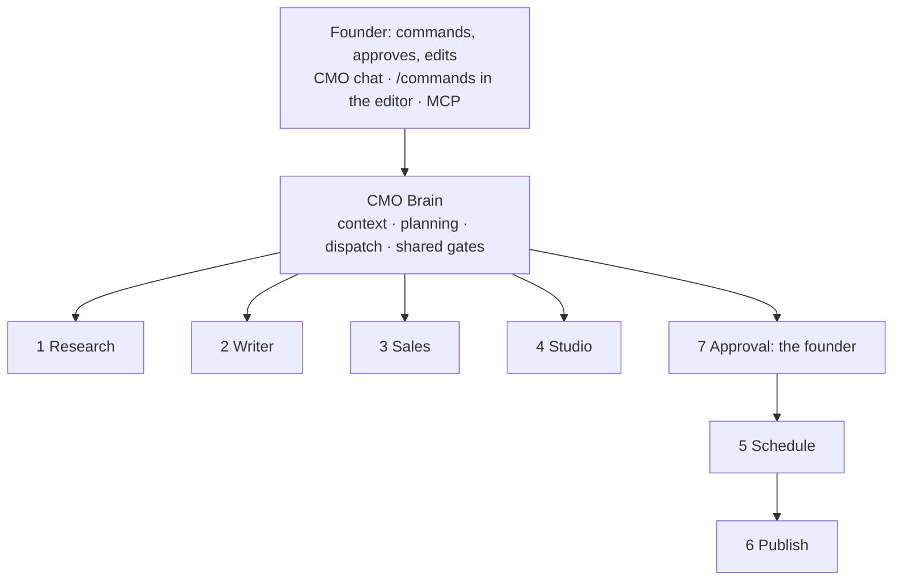

# The CMO brain and its departments

Status: **built** (`main` at `4f70a59`, 2026-11-08). Designed 2026-10-25, built in P1–P6 and the CMO review
(#169–#180). Markdown twin of [`ai-cmo.html`](ai-cmo.html), written for agents; the two must say the same thing.
[`ARCHITECTURE.md`](../../ARCHITECTURE.md) §11 summarises the same system. The order of work follows the owner's
decision of 2026-11-08: the AI CMO first, the editor last ([plan](../plans/cmo/2026-11-08-cmo-review-2-plan.md) §2).

OpenCMO is one CMO brain that plans and dispatches work to seven departments, with the founder approving
everything that goes out. The departments are the product, so the system is shaped around them, not the other way
round. It stays one system: Vercel + Supabase + Modal.

## 1. The brain and seven departments

State of the code on 2026-11-08 (`4f70a59`): ✅ done · 🟡 partial · ❌ not built.

| Part | Capabilities | Code |
|---|---|---|
| Brain | ✅ context (memories, lessons, corrections; reads the Library) · ✅ planning (`plan_week`, `review_week`, `cmo_goals`, `plan` card) · ✅ dispatch (`work_orders` tree beside `cmo_runs`) · ✅ shared gates (credits, Creem moderation, approval, weekly budget, kill switch) | `lib/cmo/`, `lib/cmo/jobs/` |
| 1 Research | ✅ competitors, outlier posts · ✅ niche short video · ✅ Reddit, X, Hacker News · ✅ metrics after posting · ✅ reply outcomes | `jobs/competitor-research.ts`, `niche-video-research.ts`, `pull-metrics.ts`, `lib/cmo/social/` |
| 2 Writer | ✅ posts and threads for X, Threads, LinkedIn · ✅ captions for Instagram, TikTok, YouTube · ✅ video brief · ✅ slide text · ✅ no-ai-slop in every writing prompt · ❌ article (later, owner 2026-11-08) | `lib/cmo/writer/`, `jobs/draft-post.ts`, `draft-thread.ts`, `lib/cmo/platforms.ts` |
| 3 Sales | ✅ find Reddit threads · ✅ scored with evidence · ✅ subreddit rules, rare product mentions · ✅ reply drafts, the founder posts · 🟡 a scan from the chat has no price card (plan S3.5) | `jobs/sales-scan.ts` |
| 4 Studio | ✅ edit your own video, mark it finished · ✅ shorts from a finished edit · ✅ slideshow (MP4 and PNG set) · 🟡 post image (built, no caller yet) · ✅ look check · ✅ slash commands; `/video` built but hidden (plan S2.4) · ✅ `render_document` → MP4 | `lib/departments/studio/`, `lib/agent/` |
| 5 Schedule | ✅ time per platform in the founder's timezone · ✅ best time from data, gaps, caps · ✅ schedule cards | `schedule_slots`, `best_slots`, `lib/cmo/schedule.ts` |
| 6 Publish | ✅ Zernio for X, Threads, LinkedIn, TikTok, Instagram, YouTube · ✅ intent link as the fallback · ✅ signed webhook with receipts | `lib/departments/publish/`, `app/api/webhooks/zernio` |
| 7 Approval | ✅ one `approvals` table with a snapshot · ✅ 11 card kinds · ✅ digest, email, web push · ✅ daily card budget | `approvals`, `approval_decide`, `lib/cmo/digest.ts`, `lib/notify/` |
| Library (shared) | ✅ four documents · ✅ Brand Kit · ✅ voice notes learned from edits · ✅ skills (video and writing) | `components/screens/library/`, `marketing_documents`, `brand_kits`, `editor_skills` |

**Library (owner decision, 2026-10-27).** Documents, Brand Kit, voice and the founder's skills are not brain state. They
live in one shared Library that the brain and every department read; the brain keeps only its plan, orders and what it
learns. Details: [`brain.md`](brain.md) section 8b.

## 2. How work flows

The owner's sketch of 2026-11-08, top to bottom. Words are written before anything is built from them.

| # | Step | What happens | Built in |
|---|---|---|---|
| 1 | Business information | The CMO reads the website and writes the four documents | `lib/cmo/onboard.ts`, `site.ts`, `documents.ts` |
| 2 | Writer | The week plan, post drafts (text for X, Threads, LinkedIn; slides for TikTok, Instagram), video briefs; every word through no-ai-slop | `plan-week.ts`, `draft-post.ts`, `draft-thread.ts`, `write_slides`, `write_video_brief`, `lib/cmo/platforms.ts` |
| 3 | Approval 1 | The founder approves the plan and the words | `approvals` |
| 4 | Video | Built from the approved words, with the Brand Kit: slideshow, post image, short clips cut from a finished edit of the founder's own video. The editor is where the founder fine-tunes by hand, at the end | `lib/departments/studio/{slideshow,shorts}`, `lib/brand.ts`, the editor |
| 5 | Approval 2 | The founder approves what was made | `approvals` |
| 6 | Post | Schedule and publish text, slideshows, videos with captions, clips; captions and hashtags per platform | `schedule_slots`, `lib/departments/publish`, `write_caption` |

Three lanes share the departments:

| Lane | Steps |
|---|---|
| Post · caption | week order (`plan_week`) → angle (research) → draft (`post_draft`, Writer + checker) → approve post → time slot (`schedule_slots`, schedule card) → post (Zernio, or the intent link) → metrics (`pull_metrics`) |
| Video · slideshow · short | week order → brief or slide text (Writer) → build (Studio order, look check) → approve (`finished_video`, `slideshow`, `shorts_batch`) → captions (`write_caption`) → time slot → post → metrics |
| Sales | scan order (`sales_scan`) → Reddit thread (ScrapeCreators) → subreddit rules → reply draft (sales + checker) → approve (`opportunities`) → founder replies by hand (no post button) → outcome (`jobs/reply-outcomes.ts`) |

Loop: metrics, the founder's edits and winning posts → `cmo_memories`, `cmo_lessons`, `cmo_corrections` and voice
notes → next week's plan.

## 3. The system, by layer

Every capability below is built unless marked. Build or buy per capability is in §7.

1. **Founder**: entry points are the app with its approval inbox, the editor and its Assistant, the CMO chat, and MCP
   from the founder's own Claude.
2. **Brain**: planning; dispatch through the `work_orders` tree (`depends_on`, budget per order); memory; the
   capability registry (`packages/contracts/capabilities.json`, one list for brain, UI, Assistant, MCP; checked by
   `lib/cmo/capabilities.check.ts`); event rules in SQL triggers.
3. **Departments**
   - Research: `competitor_research`, `niche_video_research`, outlier and social tools, `pull_metrics` (own) ·
     ScrapeCreators, Hacker News search (buy, free)
   - Writer: a writer agent per platform, `write_caption`, `write_video_brief`, `write_slides` (own) · Claude (buy)
   - Sales: `sales_scan`, score and draft, subreddit rules (own) · ScrapeCreators (buy)
   - Studio: `editor-core` ops, `render_document`, the Studio adapter and its squads (own) · fal.ai, ElevenLabs (buy)
   - Approval: checker scores first; one inbox, approval snapshot, in-app notices and web push (own) · email via
     Resend (buy)
   - Schedule: slots, best time from data, reminders (own) · clock = Modal `sweep` (own)
   - Publish: one adapter, `social_accounts` with ids only (own) · Zernio for every platform (buy) · intent link (own)
4. **Data spine (Supabase)**: `work_orders`, `deliverables`, `approvals`, `schedule_slots`, `social_accounts`
   (Zernio ids, no tokens), `credit_orders`; and `editor_projects`, `tasks`, `credit_ledger`, Storage. Every write
   goes through a gated RPC (ownership, credit hold, limits).
5. **Runtime (still one system)**: Vercel runs the web app, the approval inbox, the brain, Research, Writer and Sales.
   The Modal worker runs heavy Studio work, `publish_media`, `look_check` and the clock. The Modal MCP app has its own
   secret and a user JWT. Bought: Claude, fal, ElevenLabs, ScrapeCreators, Resend, Zernio.

## 4. The system as built, by its real call paths

Container view of `main` (`4f70a59`).

| Container | Holds |
|---|---|
| Vercel `apps/web` | UI (app screens, editor, approval inbox, Library) · API v1 (reads under RLS, writes via owner RPCs) · CMO engine `lib/cmo` (20 agents, skills, the runner of `cmo_runs` and the Studio order runner) · Assistant `lib/agent` + Generate `lib/generate` · departments `lib/departments/{studio,publish}` · Creem and Zernio webhooks, `/api/cron/*`, `/api/internal/cmo/run`. Service role: webhooks, crons, CMO runner, MCP key lookup, Assistant ledger, caption translation refunds |
| Supabase | Auth (Google OAuth, email) · Postgres: queues `tasks`, `jobs`, `cmo_runs`; the spine `work_orders`, `deliverables`, `approvals`, `schedule_slots`, `social_accounts`; CMO `marketing_documents`, `content_items`, `opportunities`, `post_metrics`, `cmo_memories`, `cmo_lessons`, `cmo_corrections`; editor `editor_projects`, `media_assets`, `generations`, `brand_kits`, `scene_codes`; money and limits `credit_ledger`, `credit_orders`, `creem_*`, `operation_log`, `rate_limits`, `card_budget`, `api_keys`, `mcp_grants`; costs `provider_usage`, `provider_prices` · Storage: `sources`, `media`, `exports`, `clips`, `brand` |
| Modal `opencmo-mcp` | `packages/mcp-server`, always warm, API key → 5-minute user JWT, paid plans only, wakes the worker; no worker secrets |
| Modal `opencmo` worker | `submit` → `run_task`; `sweep` every minute (claims, CMO dispatch, turn and job reaper); `cmo_schedule` 00:05 UTC; `cmo_digest` every hour; `cleanup` 03:00 UTC; task kinds from `packages/contracts/task-kinds.json` (`probe_media`, `generate`, `transcribe_media`, `transcribe_asset`, `render_document`, `render_stills`, `capture_page`, `look_check`, `publish_media`); `look` and `render_motion` (Remotion explainers); `opencmo/ai/moderation.py`; peak RAM < 2 GB; holds the service role |
| Bought | Claude (Anthropic) for every model call (Vercel, worker, MCP) · Creem: payments and prompt moderation · fal.ai + its NSFW classifier, ElevenLabs voice, music and Scribe (worker) · ScrapeCreators (Vercel) · Zernio (Vercel, worker) · Resend · Sentry, GitHub CI, Google OAuth |

Edges:

1. Browser → Vercel: HTTPS, session cookie, reads under RLS.
2. Browser → Storage: TUS upload with a reservation; downloads by signed URL. Files never pass through Next.js.
3. Vercel → Postgres: owner-checking RPCs; credit hold and work creation in one transaction.
4. Vercel → Modal `submit` on click; `sweep` claims within a minute if it fails.
5. Worker ↔ Postgres + Storage: lease claims, results, files (service role).
6. Modal → Vercel: the only clock (`cmo_schedule`, `cmo_digest`, `cmo_runs` dispatch, `cleanup`).
7. Founder's Claude → MCP with an API key.
8. MCP → Postgres under RLS with a user JWT; MCP → worker `wake`.
9. Browser → platform: intent link, the founder taps post (fallback with no connected account).
10. Creem → Vercel webhook, with a receipts table.
11. Worker `publish_media` → Zernio → platforms at the approved time; Zernio → Vercel signed webhook with receipts.
12. Vercel and worker → Creem Moderation API for every image and video prompt (§4b).

## 4b. Moderation is Creem's

Owner decision D8 (2026-11-05). We write no content policy of our own and run no LLM check on prompts.

| Step | Where | What |
|---|---|---|
| Prompt, on the web | `lib/generate/moderation.ts`, in `createGeneration` before credits are held | Every image and video prompt (and our own renderer's on-screen text) goes to Creem's Moderation API. `flag` blocks like `deny`. If Creem cannot answer, the request is refused |
| Prompt, again on the worker | `opencmo/ai/moderation.py` `check_prompt` | The same Creem call, because `create_generation` is also callable straight through PostgREST |
| Output | `opencmo/ai/moderation.py` | The image, or three video frames, go to Claude Haiku (vision) against Creem's rules quoted as they are (`packages/contracts/creem-policy.json`), and to fal's NSFW classifier as a second opinion. Blocked → the task fails, the credits come back, the file never reaches the bucket |

Voice, music and sound prompts are not screened (Creem does not require it); voices stay premade, with no cloning,
dubbing or lip-sync. Production enables AI images and video only with a live Creem key and a working output review
(`moderationReady`).

## 4c. What providers cost us: the spend ledger and the Costs page

`20270104010000_provider_spend.sql` ([plan](../plans/cmo/2026-11-02-provider-spend-ledger-plan.md)).

- `provider_usage`: one row per paid provider call (CMO model calls, ScrapeCreators lookups, fal and ElevenLabs
  media), in micro-USD per founder, priced when written. Model calls are priced from `agent_model_prices`, the same
  list the Assistant is charged from; `provider_prices` holds the other units. A call with no price row is stored with
  `priced = false`, never guessed. fal and ElevenLabs are recorded unpriced today (plan S3.3 adds their prices).
- `provider_spend_cap`: a daily safety cap per founder ($5 by default); read paths ask `provider_spend_allowed` before
  they spend.
- The Costs page (`app/app/settings/costs/page.tsx`) is for the owner only (`app_owners`, `provider_spend_report`):
  seven days of spend per provider, and the switches from `lib/ops/switches.ts`: UI v2, email, web push, Zernio
  posting and webhook, Creem, the social reader (ScrapeCreators), the Modal clock, MCP and the global kill switch. A
  switch only says whether a variable is set: it does not call the provider, so a bad key shows green. There is no row
  at all for Anthropic, fal or ElevenLabs, which is why the Anthropic 401 of 2026-11-08 showed nowhere. Plan S3.1
  adds a live check per provider.

## 5. Content lifecycle

`content_items_status_check`: `planned → drafting → in_review → approved → published` (+ `skipped`, `failed`). There
is no `scheduled` state on the content: the time lives on its `schedule_slots` row.

| Lane | Steps |
|---|---|
| Post, Reddit | `planned` (plan-week) → `drafting` (writer + checker) → `in_review` (card) → `approved` → slot `proposed` → schedule card → slot `waiting` → `due` → `publishing` (worker → Zernio) → `published` → `post_metrics`. Reddit replies stop at the card: the founder replies by hand |
| Video | the founder's own edit → "Mark finished" (`mark_finished`, by document hash) → `cut_shorts` order → `shorts_batch` card → captions → schedule. A brain video (`build_video`, hidden for now): storyboard card → render → look check → `finished_video` card → the same chain |
| Slideshow | `write_slides` → `build_slideshow` → MP4 and PNG set → `slideshow` card → schedule |

## 6. The nine system changes, as built

No Inngest, Trigger.dev or Temporal: the Postgres queues and the Modal clock run, and CLAUDE.md forbids a second
runtime.

| # | Change | As built |
|---|---|---|
| 1 | Work orders | `work_orders` sits **beside** `cmo_runs` instead of replacing it: a run is still the job, and its order follows it (`work_orders_follow_run`) |
| 2 | Deliverables | `deliverables` **wraps** `content_items`, `opportunities`, `cmo_insights` and `clips` (`ref_kind`, `ref_id`) instead of replacing them |
| 3 | Capability registry | `packages/contracts/capabilities.json` + schema; `capabilities.check.ts` fails on drift and on an unlisted caller |
| 4 | Headless Studio | an order runner (`lib/cmo/jobs/studio-orders.ts`) drives the Studio adapter under the founder's short-lived JWT; it holds credits before the team calls a model (`studio_order_hold`) |
| 5 | Event rules | SQL triggers on status changes (`work_orders_follow_approval`, `editor_projects_rules`, `tasks_studio_rules`, `approvals_caption_rules`, `schedule_follow_deliverable`) |
| 6 | One approval inbox | `approvals` with a snapshot (JCS content hash, price, time, account), `approval_decide`; in-app, web push (VAPID), email (Resend) |
| 7 | Schedule slots | `schedule_slots`, `best_slots`, `sweep` fires due slots |
| 8 | Publish adapter | `lib/departments/publish/adapter.ts`: Zernio for 6 platforms, intent fallback; `social_accounts` keeps ids only |
| 9 | Department folders | `lib/departments/studio`, `lib/departments/publish`; the other departments stay in `lib/cmo` |

## 7. Build or buy

Build what makes the product and what is cheap; buy what needs a model, a platform's app review, or other people's
tokens.

| Capability | Decision | Why | Cost |
|---|---|---|---|
| Dispatch, queues, clock | build | Postgres + Modal `sweep` | none added |
| Planning, memory, Writer, checker, Sales | build | the product; MIT skills exist | tokens |
| Language models | buy: Claude only (owner, 2026-11-05) | Sonnet for drafting and planning, Haiku for small tasks; one agent can move with `CMO_AGENT_<ID>_MODEL` | per token |
| Public social data | buy: ScrapeCreators; Hacker News search is free | scraping needs proxies, breaks platform terms | per call |
| Editor, render, slideshow, shorts | build | slideshow = document + `render_document`; short = transcript + LLM pick + `editor-core` ops | Modal per second |
| AI images, video | buy: fal.ai | we keep credits and the output review | per call |
| Voice, music, transcripts | buy: ElevenLabs | premade voices only | per call |
| Moderation | buy: Creem's Moderation API for prompts; Claude Haiku vision + fal NSFW for outputs, against Creem's rules (§4b) | a Creem requirement for AI generation products | per call |
| Calendar, best time, reminders | build | simple logic on our data | none added |
| In-app notices, web push | build | VAPID keys, no provider | none added |
| Email | buy: Resend | deliverability | free ~3,000/month; Pro ~$20 for 50,000 [1] |
| Posting to X | buy: Zernio (decided 2026-10-26) | all scheduled posting goes through Zernio, X included; the intent link stays as a fallback | X API price passed through: ~$0.015 a post, ~$0.20 with a link [2] |
| Posting to TikTok, IG, YouTube, LinkedIn, Threads | buy: Zernio | unaudited TikTok clients post privately to ≤ 5 users a day; Meta needs app review; the aggregator carries reviews and token refresh | ~$6 an account, first 2 free [3]; Ayrshare $149/month for one profile [4] |
| Social account tokens | buy: Zernio holds them | we keep ids only | included |
| Metrics after posting | mixed | public reading through ScrapeCreators; Zernio analytics for connected accounts | per call |
| Payments, sign-in, files, errors | keep | Creem, Supabase, Sentry | as today |

Prices are from third-party pages, not checked on the providers' pages. Not verified: whether Zernio's TikTok client
has passed audit. [1] https://automationatlas.io/answers/resend-pricing-explained-2026/ ·
[2] https://techcrunch.com/2026/04/22/x-makes-it-more-expensive-to-post-links-through-its-api/,
https://postproxy.dev/blog/x-api-pricing-2026 · [3] https://www.capterra.com/p/10036198/Late/ ·
[4] https://www.ayrshare.com/compare/buffer-api-alternative/ · TikTok:
https://developers.tiktok.com/doc/content-posting-api-reference-direct-post

## 8. Department contracts

| Dept | Takes | Gives | Agents · tools | Data | Runs on | State |
|---|---|---|---|---|---|---|
| Brain | goals, orders, metrics | week plan, work orders | `cmo`, `planner`; `plan_week`, `review_week`, `summarize_memory` | `work_orders`, `cmo_goals`, `cmo_memories`, `cmo_lessons`, `cmo_corrections` | Vercel, Modal clock | ✅ |
| 1 Research | topic, competitors | angles, evidence, metrics | `research`, `onboarding`; `competitor_research`, `niche_video_research`, `pull_metrics` | `cmo_insights`, `post_metrics`, `account_metrics` | Vercel | ✅ |
| 2 Writer | write order + context | post, thread, caption, brief, slide text | `x_writer`, `threads_writer`, `linkedin_writer`, `instagram_writer`, `tiktok_writer`, `youtube_writer`, `brief_writer`, `slides_writer`, `checker` | `content_items`, `deliverables` | Vercel | ✅ (no articles) |
| 3 Sales | scan order | scored threads + reply drafts | `sales`, `checker`; `sales_scan` | `opportunities`, `subreddit_rules` | Vercel | ✅ |
| 4 Studio | brief, founder's media, Brand Kit | short, slideshow, image, video | Studio adapter; `director`, `shorts`, `writer`, `motion`, `captions`; Assistant + `editor-core` ops | `editor_projects`, `studio_steps`, `short_batches`, `generations`, `tasks` | Vercel + worker | ✅ (`/video` hidden) |
| 5 Schedule | approved deliverables | slots, reminders | code (`schedule_propose`, `best_slots`) | `schedule_slots`, `best_slots` | Supabase + worker | ✅ |
| 6 Publish | approved slot | live post link | `publish_post` → Zernio; intent link | `social_accounts`, `zernio_receipts`, `operation_log` | worker, Vercel | ✅ (live with the Zernio key) |
| 7 Approval | everything going out | approve, edit, send back | founder; `checker` first | `approvals`, `card_budget` | Supabase | ✅ |

## 9. Six rules

1. **One kind of work order.** Everything the brain hands out is a `work_orders` row with a `kind`, a brief, a
   credit budget and a machine-readable failure. A new feature is a new `kind` + handler.
2. **One data spine.** Every output is a `deliverables` row (`kind`, `ref_kind`, `ref_id`), one set of statuses.
3. **One capability registry.** Brain, buttons, Assistant and MCP call the same tools; no private path for the
   brain.
4. **Gates live on the write path.** Ownership, credit holds and limits run in database RPCs; Creem moderation on
   web and worker. Every caller passes through them.
5. **The brain never posts.** Publish is reached only through Approval; the time and the account are part of what
   is approved, and any change needs a new approval.
6. **Every department has an eval**, measured by how often the founder approves as is.

## 10. Gaps in the code today

The gaps of 2026-10-25 are closed: the brain reaches Studio (change 4), video has approval states, Writer covers six
platforms, no-ai-slop is guidance in every writing prompt, `x-writing.md` was rewritten, hashtags follow the platform
profiles, voice is learned from edits, and email and push exist. What the audits of 2026-11-08 found:

| Gap | Evidence | Fix |
|---|---|---|
| A new founder hits walls before the CMO works | signup gives 0 credits while the landing says "Start free"; a five-step setup (`components/screens/setup/SetupScreen.tsx`) | plan S2.1–S2.2 |
| The week plan orders the most expensive job | `plan-week.ts:35` plans a one-minute AI video | plan S2.5 |
| A broken provider key does not show | the Costs page has no Anthropic, fal or ElevenLabs row, and its Creem and ScrapeCreators rows only check that a variable is set (`lib/ops/switches.ts`) | plan S3.1–S3.2 |
| Sales spends without a card | `create_task{agent:"sales"}` starts a 5-credit scan with no card (`lib/agent/cmo-tools.ts`) | plan S3.5 |
| The post image squad has no caller | nothing outside the acceptance runs creates a `build_post_image` order | open |
| The `moderation` agent's role text still says it checks prompts | `lib/cmo/agents/registry.ts`; it now reviews outputs only | small fix, out of this plan |

## 11. Order of work

**Ranked by the CMO loop (owner, 2026-11-08):** does it make the loop of §2 work for a paying founder, end to end?
Editor work comes after.

1. Paid-first entry and the first week within minutes (plan S2.1–S2.3).
2. `/video` hidden and the week plan without AI video (S2.4–S2.5).
3. No dead ends, one card per job, Sales behind a card (S2.6, S3.5–S3.6).
4. Providers you can see: Costs page rows, deploy check, priced fal and ElevenLabs spend (S3.1–S3.4).
5. Owner: the Anthropic key everywhere, Creem live key and review, Zernio checks, Vercel Hobby.
6. Then fewer cards a week, one Assistant, and the editor (their own plans).

**History.** The 2026-10-25 order (Writer and No AI Slop → the spine → registry and Studio takes a script → Approval
inbox, notifications, Schedule → Studio slideshow and clips → Publish on Zernio) was built in full in P1–P6.

## 12. The pages

One HTML + markdown pair per part in this folder: [`brain.md`](brain.md), [`studio.md`](studio.md),
[`approval.md`](approval.md), [`schedule-publish.md`](schedule-publish.md), [`writer.md`](writer.md),
[`research-sales.md`](research-sales.md), and the end-to-end week in [`workflow.md`](workflow.md).
