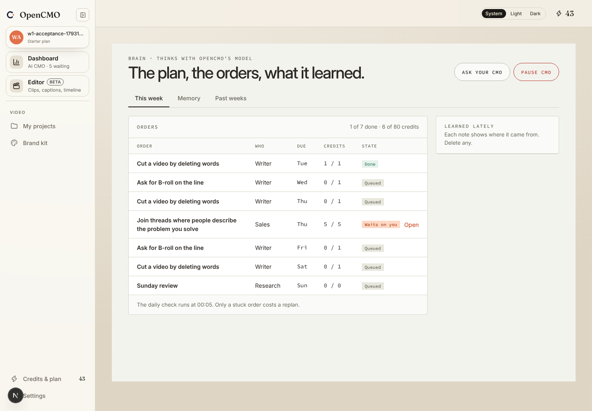
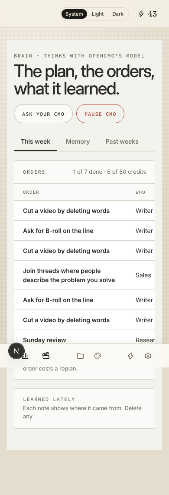

# Brain wave 1 acceptance (W1-6)

Run on 2026-10-27 against a local Supabase (CLI 2.117.0, Postgres 17) with fake providers, through
[`apps/web/lib/screens/acceptance.e2e.ts`](../../../apps/web/lib/screens/acceptance.e2e.ts). Every screen was read the
way the route reads it (loader under the founder's RLS session, then `compose` with production rules), and the routes
were checked through `next dev` with a signed-in session.

```
  ✓ onboarded: documents saved, starter plan, 50 credits
  ✓ plan_week wrote the tree: 7 orders (5 Writer, 1 Sales)
  ✓ runs finished: 6 cards in the queue (1 post, 5 replies), the post's order waits on you
  ✓ approved the post: queue 6 → 5, log “You approved “Cut a video by deleting words””
  ✓ Pause CMO refused the next run; Resume cleared it
  ✓ digest sent to the local mail catcher: “5 things wait on you · today”
  ✓ Writer, Sales and Research read live rows; eight screens pass the release gate
  ✓ Library reads the three documents live
```

Re-run on 2026-10-28 after the planner's review fixes: the post draft is now enqueued by the real 00:05 schedule
(`enqueueDueLoops`), which links the run to its order and calendar item.

Also on that stack: `supabase test db` 115 files, 1814 assertions, pass; `supabase db lint --level warning` clean;
`NEXT_PUBLIC_OPENCMO_UI=v2 npm run build` clean.

## Live flags as served by `GET /api/v1/screens/[name]`

| Screen | Live | Not live (sample outside production, empty in production) |
|---|---|---|
| Dashboard | cmo, week, team, log, outToday, digest, queue | results (Zernio metrics, wave 3) |
| Brain | cmo, week, orders, learned, corrections, pastWeeks | — |
| Settings | cmo, weeklyCreditBudget, timezone, digestHour, plan | accounts (Zernio, P0) |
| Library | site, documents, brandKits | voice, skills (Writer W0–W1) |

## Dashboard data after the approval (no Dashboard UI yet: Session B's U3)

Week: no approved goal yet (a fresh founder), 1 of 7 orders done, 6 of 80 credits. Queue: 5 cards (reply).

| Node | State | Line | Waiting |
|---|---|---|---|
| Research | idle | Next: “Sunday review” | 0 |
| Writer | idle | Next: “Ask for B-roll on the line” | 0 |
| Studio | idle | Idle | 0 |
| Sales | idle | “Join threads where people describe the problem you solve” waits on you | 5 |
| Schedule | idle | Idle | 0 |
| Publish | idle | Idle | 0 |

| Who | Live log, newest first |
|---|---|
| Writer | You approved “Cut a video by deleting words” |
| Sales | “Join threads where people describe the problem you solve” waits on you |
| Sales | Started “Join threads where people describe the problem you solve” |
| Writer | “Cut a video by deleting words” waits on you |
| Writer | Started “Cut a video by deleting words” |
| Sales | Planned “Join threads where people describe the problem you solve” |

## Brain page with live data (Session C's S5)

Frame: [`Brain.dc.html`](2026-10-27-app-redesign-frames/static/Brain.html).





Open: the Dashboard screenshots wait for Session B's U3; at 390 px the orders table is cut on the right (Session C,
noted in Requests).
