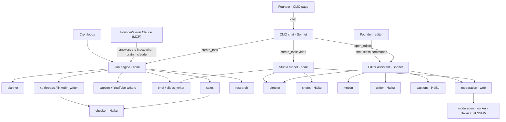

# Agent team, model roles, no-ai-slop, moderation and charging (spec)

Date: 2026-11-05. Owner conversation 2026-11-04 → 11-05 (session `moderation-policy-agent-team`), PRs #165, #167, #168,
#169 (merged), Creem PR #166 (open, test mode) and the Sales finder spec #133 (pulled into this branch).

This spec records what was decided, what is already on `main`, and what is still to build. It replaces the
"Recommendations" of [`../../research/agents/2026-11-04-agent-team-model-map.md`](../../research/agents/2026-11-04-agent-team-model-map.md),
which described the code before #169. The live map is the artifact https://claude.ai/artifact/93Bja2KhKZp15KpyBKwDPs.

## 1. Decisions (owner)

| # | Decision | Date | State |
|---|---|---|---|
| D1 | **Two brains.** The CMO chat is the whole product's lead: it makes AI videos, slideshows and animations (through Studio), posts and Reddit replies. The editor has its own Assistant, for editing the videos the user uploads. | 2026-11-05 | Matches the code |
| D2 | **One model provider: Claude.** No Gemini, no Groq or other OpenAI-compatible endpoint. Less to manage. | 2026-11-05 | Done, #169 |
| D3 | **Sonnet leads and writes; Haiku does small tasks.** Groq never writes copy. | 2026-11-05 | Done, #169 |
| D4 | **Haiku is not the chat lead.** It can call tools, but it is weaker than Sonnet at choosing among ~90 tools and planning several steps; it runs inside tools instead. | 2026-11-05 | Done (Sonnet leads) |
| D5 | **Every word a person reads or hears goes through no-ai-slop**: scripts, voice-overs, storyboards, on-screen text, posts, captions, titles, plans, replies. | 2026-11-05 | Done, #169 |
| D6 | **Creem screens every image and video prompt**, as Creem requires. | 2026-11-05 | Built in #166 (test mode) |
| D7 | The Editor Assistant stays outside the agent registry for now: it already runs Sonnet. | 2026-11-05 | No work |
| D8 | **Moderation is Creem's.** Creem screens every image and video prompt; we run **no LLM prompt check** of our own and write no policy of our own. The only LLM step left is a **review of the finished output before the user gets it** (Haiku vision on the image or frames, plus fal NSFW), judged against Creem's rules quoted as they are. | 2026-11-05 | Done (T4, `cmo-review`) |
| D9 | **Charge before running, then run in one go.** Storyboard and one credit estimate for the whole job → the user confirms once → credits held → the job runs to the end with no second approval. No paid step before the confirmation. | 2026-11-05 | Done (T9 phases 1–6, `cmo-review`) |

## 2. Who calls whom

- **CMO chat** (`lib/agent/scope.ts` `cmoScope`, `lib/agent/cmo-tools.ts`): talks with the founder, reads the site,
  researches, hands work to the team with `create_task`, and sends video edits to the editor with `open_editor` (the
  prompt is sent as the founder's own request, so it is taint-gated).
- **Editor Assistant** (`lib/agent/model.ts`, `providers/anthropic.ts`, `prompt.ts`): edits the open clip through
  editor-core ops, writes storyboards, voice-over scripts and Remotion explainer code itself, and calls the video team
  (`plan_video` → writer + motion, `create_video` → director).
- **Job engine** (`lib/cmo/jobs/runner.ts`, `think.ts`, `llm.ts`) and **Studio runner** (`lib/cmo/jobs/studio-orders.ts`)
  are code: every model call goes through `structured()` of one registry agent, under the founder's daily spend cap.
- **Brain switch** (`lib/cmo/brain.ts`): when the founder cannot pay for a turn or Claude cannot answer for an account
  reason, jobs stop at `think()` and ask the founder's own Claude through the MCP inbox.

## 3. Model roles

All calls run on Claude. `lib/cmo/agents/registry.ts` resolves every agent to `anthropic`; `CMO_AGENT_<ID>_MODEL` (a
Claude id) and `CMO_AGENT_<ID>_API_KEY` still move one agent.

| Tier | Agents | Model | Why |
|---|---|---|---|
| Lead | CMO chat, Editor Assistant | `claude-sonnet-5-5` | Long conversations, many tools, explainer code; what the user feels directly |
| Draft | onboarding, planner, x / threads / linkedin_writer, instagram / tiktok / youtube_writer, brief_writer, slides_writer, sales, research, director, motion | `claude-sonnet-5-5` | Copy, scripts and plans are the product |
| Check | checker, writer (title card), captions (translation), shorts, moderation | `claude-haiku-5-5` | Short, schema-bound, cheap |
| Worker | output moderation, look judge, keyframe text hint | `claude-haiku-5-5` (vision) + fal NSFW | Same key as the web |

Rules (also in `.claude/skills/llm-provider-keys/SKILL.md`):

- Adding a provider is an owner decision. The deploy check notes any retired key still set (`RETIRED_KEYS` in
  `packages/engine/opencmo/deploy_env.py`).
- The checker grades drafts in its own context; there is no longer a second provider to grade on.
- Claude out of credit or with a revoked key is remembered (`lib/llm-health.ts`) so the brain switch and the next
  caller know; it is never reported as a content block.
- Chats started on Gemini before #169 cannot continue: the user starts a new chat (409).
- Media models served through fal (Veo, Nano Banana, Gemini TTS) are not model providers of ours; they run on `FAL_KEY`.

**Option, not planned:** run the Assistant eval (`npm run agent:eval -- --provider anthropic --yes`) with Haiku as the
Assistant to measure D4 instead of assuming it. Do it only if Sonnet's cost becomes a problem.

## 4. no-ai-slop

`NO_AI_SLOP` in `apps/web/lib/cmo/skills/index.ts` is the one shared block (the skill
`lib/cmo/skills/no-ai-slop.md`, MIT, Peter Yang). It sits inside each cached system prompt.

| Writes for a reader | Where | Since |
|---|---|---|
| Posts and threads, their review | `jobs/draft-post.ts`, `draft-thread.ts` | before #169 |
| Reddit replies | `jobs/sales-scan.ts` | before #169 |
| Captions, YouTube, video brief, slides | `cmo/writer/prompts.ts` | before #169 |
| Editor Assistant (storyboards, voice-over scripts, replies) | `agent/prompt.ts` (`SYSTEM_PROMPT` = `SYSTEM_RULES` + guide) | #169 |
| CMO chat (was read on demand only) | `agent/scope.ts` | #169 |
| Video director (`/video`, Studio) | `agent/create-video.ts` | #169 |
| Intro writer | `agent/motion-guide.ts` `WRITER` | #169 |
| Shorts titles | `departments/studio/shorts/squad.ts` | #169 |
| Onboarding documents, weekly plan, weekly review, both research jobs, judge | `cmo/generate.ts`, `jobs/*` | #169 |
| MCP clients (the founder's Claude) | `packages/mcp-server/src/server.ts` instructions: `read_cmo_playbook no-ai-slop` | #169 |

Deliberately without it: caption **translation** (must keep the speaker's words) and the **motion** director (plans
beats, writes no words). The founder's own rules and voice notes still win over the guide.

Enforced by `lib/cmo/skills/no-ai-slop.check.ts` (in `check:contracts`): a writing prompt that loses the guide fails CI.
New prompts that write for a reader must be added to that check.

## 5. Moderation

### 5.1 Layers today (`main` after #169)

| Layer | Where | What | Model |
|---|---|---|---|
| Prompt, before credits are held | `lib/generate/moderation.ts` `moderateText` (generate route, Assistant price card, `/video` pieces, `add_explainer`, MCP) | the spec's words | Haiku |
| Prompt, again on the worker | `opencmo/ai/moderation.py` `check_prompt` (a direct PostgREST call skips the web) | the same words | Haiku |
| Input images and video | `check_input`, `check_input_video` | frames the user feeds in | Haiku vision |
| Output | `check_output` | the image, or 3 frames at 10/50/90 % | Haiku vision + fal NSFW |
| Look check, page capture | `look_check_task.py`, `capture_page_task.py` | export frames; captured pages | Haiku vision |

Policies on `main` today (all five are replaced by one Creem policy, §5.3):

- `POLICY`: AI images and video. Strict: no identifiable real people, no other brands' logos or branded products.
- `AUDIO_POLICY`: voice, music and sound. Scripts may name people and products.
- `MOTION_POLICY` (#165): our own Remotion renderer. On-screen text may name brands and competitors ("Post drafts to
  X", "faster than CapCut"). It still blocks harmful content and made-up quotes or endorsements of named real people.
- `OWN_FOOTAGE_POLICY`: the user's own footage (background removal, edits of the clip's video). A recognisable person is
  fine.
- `CAPTURE_POLICY`: public pages quoted as they are.

User-facing results:

| Case | Message | Credits |
|---|---|---|
| Blocked on the web | "This request goes against our content policy. Change it and try again." (422) | never held |
| Blocked on the worker | "This result was blocked by our content policy. Your credits were refunded." | refunded |
| Claude could not answer, busy | retried in place, then "Could not check the result. Please try again." | refunded |
| Claude out of credit or key revoked (#165) | "Content checks are unavailable right now, so this could not be made. Your credits were refunded." | refunded |
| No key in production | "Content checks are not set up on this server…" | never held / refunded |

The "unavailable" row is the production bug from 2026-11-04: an unpaid checker used to be reported as a policy block,
so users rewrote prompts that were fine.

### 5.2 Creem screening (#166, test mode)

Facts from Creem's docs (`docs/creem-llm.txt` on `creem-payment`, L15378-15560, L23460-23480) and #166's V3 run:

- `POST /v1/moderation/prompt`, header `x-api-key`; `api.creem.io` for `creem_` keys, `test-api.creem.io` for
  `creem_test_` keys. Body `prompt`, optional `external_id`. Answer: `decision` = `allow` | `flag` | `deny`, and
  `usage.units`.
- **Required** for every prompt of an AI image or video product, or the account can be suspended and funds held. Not
  required for audio, music, text, upscaling or background removal.
- $0.30 per 1,000 units, one unit per 1,000 characters, repeated prompts free. 1-3 s per call through the CLI.
- **The sandbox answered `allow` to every prompt tried, even clearly prohibited ones.** `flag` and `deny` are tested only
  with a fake fetch. Only live calls count for Creem's review.
- Creem does not publish its categories. We cannot assume it blocks real people or other brands.

What #166 builds:

- Web: `screenWithCreem` runs first in `moderateText`, before our check and before credits are held. `flag` blocks
  like `deny`. Unreachable or an unknown decision → 503 "Could not check". Audio kinds skip it. Motion text is screened
  too (the user's words still become a video). `external_id` = `job_<id>`.
- Worker: `_screen_with_creem` at the top of `check_prompt`, for the same reason the worker checks prompts at all (a
  direct RPC call). Creem unreachable → UNAVAILABLE, refunded.
- Production ignores a `creem_test_` key, and AI media stays off without a live Creem key (`allowedHere` in
  `lib/generate/models.ts`).
- The output check on the worker is unchanged: Creem only sees prompts.

### 5.3 Target: Creem moderates, we only review the output

Owner, 2026-11-05: "Creem does the moderation for us. Drop the LLM moderation check entirely; keep only a review
before the result reaches the user."

| Step | Today | Target |
|---|---|---|
| Image / video prompt (web, before the hold) | Creem (#166), then Haiku | **Creem only** |
| Image / video prompt (worker, a direct RPC call) | Creem (#166), then Haiku | **Creem only** |
| Motion (our Remotion renderer) | Creem (#166), then Haiku with `MOTION_POLICY` | **Creem only** |
| Voice, music, sound prompt | Haiku with `AUDIO_POLICY` (Creem skips audio) | **No check** (Creem does not require one, L23470) |
| Input images and video fed to a model | Haiku vision | **Removed**: what comes out is reviewed |
| **Output** (the image, or 3 frames at 10/50/90 %) | Haiku vision + fal NSFW, our `POLICY` | **Kept**: Haiku vision + fal NSFW against `CREEM_POLICY` |
| Look check of an export, page captures | Haiku vision | Kept, `CREEM_POLICY` |

`CREEM_POLICY` is not a policy of ours: it quotes Creem's published rules and adds nothing (no suggestive, borderline
or sexually provocative material; no face-swap, deepfake or face-manipulation; no NSFW or harmful content, as the
Acceptable Use Policy Creem requires says). It lives once in `packages/contracts/` so the web and the worker read the
same words. `POLICY`, `AUDIO_POLICY`, `MOTION_POLICY`, `OWN_FOOTAGE_POLICY`, `CAPTURE_POLICY`, `moderateText`'s LLM
path, `check_input` and `check_input_video` go away.

What this changes:

- A prompt that only names a real person or a brand is no longer blocked by us; Creem decides. A deepfake or face-swap
  is still blocked, by Creem on the prompt and by the output review.
- Voice-over scripts are not checked. Voices stay premade (no cloning, dubbing or lip-sync), as Creem forbids face and
  voice manipulation.
- Cost: one Haiku vision call per finished image or video, and no Haiku call per prompt.
- An output blocked by the review is refunded to the user after fal was paid; that cost is ours, and it is rare when
  Creem screens the prompt first.

### 5.4 Merging #166 onto `main`

#166 branched before #169. Its `moderation.ts` and `moderation.py` still import Gemini and OpenAI-compatible code that
no longer exists. When rebasing:

- keep `screenWithCreem`, `creemModerationKey`, `_screen_with_creem`, `_creem_key` and their tests;
- take `main`'s Claude-only checker (`moderateText` without `gemini`, `askClaude` only; worker `_check_claude` only,
  `UNAVAILABLE` on an unpaid key);
- then apply §5.3 (Creem only on prompts, output review with `CREEM_POLICY`) in a follow-up.

## 6. Charge before running, then run in one go

Owner, 2026-11-05: "running first and charging after loses money. Show the storyboard and the credit estimate; once the
user confirms, run everything in one go."

### 6.1 Where money leaks today

| Flow | Today | Leak |
|---|---|---|
| `/video` (`lib/agent/create-video.ts`, `long-take.ts`) | Card 1 → keyframes made → contact sheet → card 2 → shots | Two stops; keyframes and the director's and Assistant's tokens are spent before the user decides to go on |
| Explainer (`preview_explainer`, `add_explainer`) | The Assistant writes code and renders previews, then shows the price card | Previews are paid from the turn's hold (raised to 20 credits), outside the price the user sees |
| Studio (`lib/cmo/jobs/studio-orders.ts`) | The video team's model calls are recorded at 0 credits (QA checklist H10) | We pay the model, the user does not |
| Assistant turns | Usage above the turn's hold is never billed (H10) | We pay the rest |
| Output blocked by moderation | The user is refunded; fal was already paid (H07) | We pay fal |

### 6.2 Target flow

1. **Plan (cheap, before any confirmation).** The director, or the Assistant, writes the storyboard: say, picture,
   motion and on-screen text per beat, voice and music. Only the planning tokens are spent here, inside the turn's
   normal hold.
2. **One card.** The storyboard and one estimate covering everything the job will spend: keyframes, shots, voice,
   music, explainer render, and a token allowance for the agents that run it. The estimate rounds up; nothing is
   asked again later.
3. **Confirm → hold → run.** One `credit_hold` for the whole estimate, in the same transaction that creates the work
   (web rule 1). The job then runs end to end: keyframes, then shots, voice and music, assembly. No contact sheet stop,
   no paid preview.
4. **Settle.** `credit_settle` charges what was used; the rest comes back. A failed or blocked step refunds only its
   own share.
5. **After.** Redo of a keyframe or a shot is a new job with its own card and price.

Per flow:

- `/video`: `create_video` and `animate_video` merge into one approval. Keyframes and shots run in one job; the
  contact sheet becomes a view of the finished video with Redo buttons, not a gate.
- Explainer: the storyboard and the direction are confirmed with the price; the paid render runs after. The Assistant
  may check its own code with frames it renders only inside the held amount (the hold covers a fixed number of
  preview frames), never before the confirmation.
- Studio: the card that starts a video carries the full estimate, the video team's model calls included, and they are
  charged from that hold instead of at 0.
- Assistant turns: the hold of a turn that will run paid tools is the card's estimate, so usage above it is the
  exception it was meant to be, and it is billed.
- Moderation stays in front of the hold: Creem screens the prompts before the card is shown, so a blocked
  prompt costs nothing. An output blocked after generation is still refunded to the user; that cost is ours, and it
  is why the prompt check runs first.

Trade-off: the user no longer sees the keyframes before the shots are made. Bad frames are fixed with Redo after, at a
price. The estimate must carry a margin, because the job does not stop to ask for more credits.

## 7. Production fixes made in this session

| PR | Fix |
|---|---|
| #165 | Unavailable ≠ blocked (§5.1); `MOTION_POLICY`; the agent-team research report |
| #167 | A strict-tool grammar the API refused ("compiled grammar is too large") is remembered per instance, instead of a 400 and a resend on every Assistant step |
| #168 | A dropped stream or a failed reload no longer turns the panel into "The assistant isn't available on this server yet"; it reads again every 5 s, and a lost connection says the turn keeps running |
| #169 | Claude only (§3); no-ai-slop everywhere (§4) |

## 8. Still to do

| # | Work | Why | Size | Blocks on |
|---|---|---|---|---|
| T1 | Anthropic key and credit on Vercel, Modal `opencmo` and `opencmo-mcp` | One provider now: without it AI media is off and the CMO falls back to the founder's Claude | S (ops) | none |
| T2 | Remove `GEMINI_API_KEY`, `GROQ_API_KEY`, `OPENAI_COMPAT_*`, `OPENCMO_MODERATION_VISION_MODEL`, `CMO_LLM_PROVIDER(S)` from Vercel and Modal; run `check_deploy_env.py` | Unused secrets | S (ops) | #169 deployed |
| T3 | **Done** for the code: #166 merged `main` (744ee6c5) and was merged into `cmo-review` (cfcb4327). Still to do: go live with a live Creem key and request Creem's review | Creem compliance | M | T1 |
| T4 | **Done**: Creem alone screens image and video prompts (web `moderateText`, worker `check_prompt`), audio is not screened, the input checks and our five policies are gone; the output review, page captures and the look check use `CREEM_POLICY` from `packages/contracts/creem-policy.json` | D8 | S | T3 |
| T9 | §6: [plan](2026-11-06-charge-before-running-plan.md) (approved 2026-11-06): one card, one hold per job, no second approval; six phases. **Done, phases 1–6** (turn overage, `credit_orders`, keyframe chaining, `/video` in one go, Studio hold, explainer plan first) | D9 | L | none |
| T5 | **Done** (`aa002d45`): keep-alive for the Assistant's SSE stream (a comment line every 15 s in `lib/agent/sse.ts`, `sse.check.ts`) | Streams over 2 min dropped in production; still to confirm on Vercel with a turn over 2 min | S | none |
| T6 | Strict tools for credit-spending tools only (`generate_media`, `add_explainer`, `animate_video`…) | Since #167 the editor runs without strict at all; strict matters most where a bad call costs money | S | a real-API test of the grammar size |
| T7 | **Done** (`70378ae3`): the Generate panel saves under `Generated/` like the Assistant. Items already in `generated/` stay (their path is also the clip's `src`) | A duplicate folder, case only | S | none |
| T8 | Optional: split an "explainer coder" role from the Assistant | Only if an eval shows Sonnet writes weak explainer code | M | eval |

## 9. Sales finder (#133)

The Sales finder spec ([`2026-10-31-sales-finder-spec.md`](2026-10-31-sales-finder-spec.md)) is merged into this branch
unchanged. Under this spec its agents run as follows: `sales` drafts on Sonnet with no-ai-slop (already in
`sales-scan.ts`), and thread scoring runs on the Haiku `checker`. The finder's own model calls must use registry agents,
never a new provider.

## 10. Answered questions

| # | Question | Answer (owner, 2026-11-05) |
|---|---|---|
| Q1 | After Creem, keep Haiku on image/video prompts? | No: Creem only; Haiku reviews the output before the user gets it (D8) |
| Q2 | Keep Haiku on audio prompts? | No: Creem does not require it for audio (D8) |
| Q3 | Measure Haiku as the Assistant with the eval? | Not now |
| Q4 | Keep our own rules on real people and other brands' logos? | No: Creem's rules only (D8) |
