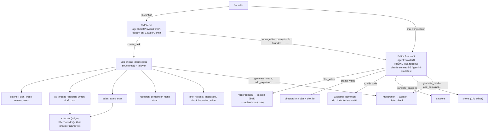

# AI agent & automation: bản đồ agent team — model nào gọi model nào, và moderation đang lỗi ở đâu  (2026-11-04)

## TL;DR

- **Lỗi "không render được vì policy" có hai nguồn, cả hai đã sửa trong PR này:**
  1. Worker báo *"This result was blocked by our content policy"* cả khi **không checker nào trả lời được** (hết credit,
     key sai). Khoá Gemini trong môi trường session này trả `402 prepayment credits are depleted` — nếu production
     dùng cùng khoá (hoặc Anthropic/Groq hết tiền), mọi ảnh/video bị báo là "vi phạm policy" dù prompt sạch.
  2. Explainer/motion clip (renderer Remotion của mình) bị kiểm bằng **policy chặt của ảnh/video AI**, cấm "another
     company's ... branded product" và "a named ... person". Chữ trên màn hình kiểu "Post drafts to X", "Find Reddit
     threads", "nhanh hơn CapCut" là tên brand → bị chặn. Video marketing của chính OpenCMO đụng đúng chỗ này.
- **Creem Moderation API chỉ kiểm prompt** (`POST /v1/moderation/prompt`), bắt buộc với mọi merchant làm ảnh/video
  AI. Nó **không thay được** bước kiểm đầu ra (ảnh/khung hình) ở worker — bước đó phải giữ.
- Agent team có **3 runtime gọi model khác nhau**: editor Assistant (không đi qua registry), CMO chat (registry,
  chỉ Claude/Gemini), và các job/specialist `structured()` (registry, cả Groq). Thứ tự provider mặc định là
  **`openai,anthropic,gemini`**: hễ có `GROQ_API_KEY` là mọi agent viết bài/kịch bản chạy `gpt-oss-120b` trên Groq.
- Khuyến nghị: ghim env từng agent trên production theo bảng ở cuối; không đổi code registry (đã đủ linh hoạt).

## Phát hiện

### 1. Moderation hôm nay chạy thế nào

| Lớp | File | Kiểm gì | Model |
|---|---|---|---|
| Web, trước khi giữ credit | `apps/web/lib/generate/moderation.ts` (`moderateText`) | Lời của prompt/spec | Agent `moderation` của registry (tier `check`): Groq `gpt-oss-20b` → `claude-haiku-5-5` → `gemini-flash-latest`, theo `CMO_LLM_PROVIDERS` |
| Web, lúc báo giá trong Assistant | `apps/web/lib/agent/scope.ts` (`screen`, `add_explainer`), `screen-pieces.ts` (`/video`) | Như trên, trước khi hiện thẻ duyệt | Như trên |
| Worker, trước provider | `packages/engine/opencmo/ai/moderation.py` (`check_prompt`) | Lời lần nữa (RPC gọi thẳng PostgREST không qua web) | Groq `llama-4-scout` (vision) → Haiku 5.5 → Gemini Flash |
| Worker, ảnh đầu vào | `check_input`, `check_input_video` | Ảnh/khung hình user đưa vào model | Như trên + fal NSFW |
| Worker, đầu ra | `check_output` | Ảnh hoặc 3 khung hình 10/50/90% | Như trên + fal NSFW (nếu có `FAL_KEY`) |
| Worker, look check / capture | `look_check_task.py`, `capture_page_task.py` | Khung hình bản export; screenshot trang web | Như trên |

Policy theo loại: `POLICY` (ảnh/video, chặt: cấm người thật nhận diện được, logo/brand), `AUDIO_POLICY` (voice: được
nhắc tên người và sản phẩm), `OWN_FOOTAGE_POLICY` (video của chính user), `CAPTURE_POLICY` (screenshot trang công khai).

**Lỗi A — hết credit bị báo là vi phạm policy.** Trong `_check_policy`, khi checker cuối cùng trả `401/402/403` (hoặc
Anthropic `400 credit balance`), code ném `ProviderError(BLOCKED)`. User thấy "blocked by our content policy", sửa
prompt mãi không được. Checklist QA đã ghi đúng bẫy này (`docs/qa/2026-11-production-test-checklist.md`, I11). Look
check còn ghi "A frame did not pass the content check" lên thẻ. fal NSFW `401/402/403` cũng bị coi là chặn.

Đã thử thật: khoá `GEMINI_API_KEY` của session này → `402 Your prepayment credits are depleted`.

**Lỗi B — explainer bị kiểm như ảnh AI.** `add_explainer` gọi `moderateText(..., { kind: "video" })`, và
`createGeneration` dùng `model.kind` (`motion-explainer`/`motion-clip` có `kind: "video"`), nên chữ trên màn hình bị
xét bằng `POLICY`. Worker `check_prompt` cũng vậy. Nhưng chính docstring của worker nói chữ của scene "draw what the
user could already put on the timeline as a text layer, where nothing is moderated". Từ chữ không thể ra ảnh người
thật hay logo. *(Ý kiến, chưa có log production để đo tỉ lệ chặn nhầm — nên đo sau deploy.)*

### 2. Đã sửa gì

- `UNAVAILABLE` mới ở worker: "Content checks are unavailable right now, so this could not be made. Your credits were
  refunded." — không checker nào trả lời được (không phải bận) → task fail, hoàn credit, **không giao file**, nhưng
  không gọi là "blocked". Log `error` ghi rõ provider nào. Look check bỏ qua (không ghi "frame failed").
- `MOTION_POLICY` (web) / `MOTION_PROMPT_POLICY` (worker), chữ giống hệt nhau: vẫn chặn sexual, minors, bạo lực,
  hate, **trích dẫn/endorsement bịa gán cho người thật có tên**, nhái giọng; cho phép nhắc tên người, công ty, app,
  so sánh với đối thủ. Chỉ áp cho provider `opencmo-motion`. Ảnh/video AI giữ nguyên policy chặt.

### 3. Creem Moderation API

Theo docs Creem (qua kết quả tìm kiếm; `docs.creem.io` bị chặn mạng trong session này nên **chưa đọc được trang
gốc** — cần đọc lại schema, category và giá trước khi code):

- `POST /v1/moderation/prompt`, header `x-api-key`; sandbox `test-api.creem.io` (key `creem_test_`), production
  `api.creem.io` (key `creem_`).
- Bắt buộc gọi cho **mọi** prompt của sản phẩm ảnh/video AI; không gọi = không tuân thủ, có thể bị khoá tài khoản
  không báo trước.
- Chỉ kiểm text prompt, không nói gì về kiểm đầu ra.

Hệ quả cho thiết kế:

1. Creem thay **bước đầu tiên** của `moderateText` (web), chạy trước LLM. Deny của Creem → 422 như hiện tại.
2. **Giữ** kiểm đầu ra ở worker (vision LLM + fal NSFW): prompt sạch vẫn có thể ra ảnh bẩn, và luật sản phẩm (không
   người thật, không logo) là của mình, Creem không biết.
3. Có giữ LLM check prompt sau Creem không: phụ thuộc category của Creem. Nếu Creem không có "real person" và
   "brand", giữ LLM của mình **chỉ cho ảnh/video AI**; motion và voice chỉ cần Creem. Đọc docs rồi quyết.
4. "Mọi prompt": gồm cả explainer/motion và voice? Đọc docs. Nếu có, Creem phải chạy ở cả `add_explainer` và
   `screenPieces`, và ở worker `check_prompt` (đường RPC gọi thẳng).
5. Creem lỗi/không trả lời → 503 "Could not check", **không** báo là vi phạm (đúng bài học của lỗi A).

### 4. Bản đồ agent team: ai gọi ai

Ba runtime, khác nhau ở chỗ chọn model:

| Agent | Ai gọi | File | Tier | Mặc định (Groq → Claude → Gemini) |
|---|---|---|---|---|
| Editor Assistant | user trong editor, CMO qua `open_editor` | `lib/agent/model.ts`, `providers/anthropic.ts` | — | `claude-sonnet-5-5` (adaptive thinking, server fallback) hoặc `gemini-pro-latest`; env `OPENCMO_AGENT_PROVIDER`, `AGENT_GEMINI_MODEL` |
| `cmo` (chat) | founder | `lib/agent/session.ts`, `scope.ts` | draft | Claude Sonnet / Gemini Pro (bỏ qua Groq: chưa có chat provider OpenAI-compat) |
| `onboarding` | đăng ký site | `lib/cmo/generate.ts` | draft | gpt-oss-120b → Sonnet → Gemini Pro |
| `planner` | CMO `create_task`, lịch | `jobs/plan-week.ts`, `review-week.ts` | draft | như trên |
| `x_writer`, `threads_writer`, `linkedin_writer` | planner/CMO | `jobs/draft-post.ts`, `draft-thread.ts` | draft | như trên |
| `brief_writer`, `slides_writer`, `instagram/tiktok/youtube_writer` | writer jobs, studio | `lib/cmo/writer/jobs.ts` | draft | như trên |
| `sales` | CMO/lịch | `jobs/sales-scan.ts` | draft | như trên |
| `research` | CMO | `jobs/competitor-research.ts`, `niche-video-research.ts` | draft | như trên |
| `checker` | sau draft/sales/memory | `jobs/judge.ts`, `classify-edits.ts`, `summarize-memory.ts` | check | **provider khác người viết** (`otherProvider`): gpt-oss-20b / Haiku 5.5 / Gemini Flash |
| `motion` | Assistant `plan_video` | `lib/agent/video-team.ts` | draft | gpt-oss-120b → Sonnet → Gemini Pro |
| `writer` | Assistant `plan_video` | `video-team.ts` | check | gpt-oss-20b → Haiku → Flash |
| `director` | Assistant `create_video` | `lib/agent/create-video.ts` | draft | như draft |
| `captions` | editor dịch caption | `lib/editor/captions-run.ts` | check | như check |
| `shorts` | studio shorts | `lib/departments/studio/shorts/squad.ts` | check | như check |
| `moderation` | mọi lượt sinh | `lib/generate/moderation.ts`, worker | check | như check; worker dùng `llama-4-scout` cho ảnh |

Ghi chú đáng để ý:

- **Thứ tự mặc định đặt Groq đầu** (`PROVIDER_KINDS = ["openai", "anthropic", "gemini"]`). Rẻ, nhưng mọi bài X,
  kịch bản video và kế hoạch tuần sẽ do `gpt-oss-120b` viết nếu production có `GROQ_API_KEY` và không đặt
  `CMO_LLM_PROVIDERS`. Chất lượng copy là thứ user trả tiền — đây là quyết định nên đặt bằng tay, không để mặc định.
- **Editor Assistant tách khỏi registry.** Không đặt được key riêng, không dùng được Groq/Opus qua env
  `CMO_AGENT_*`; muốn đổi model phải sửa `ANTHROPIC_MODEL`. Đây là agent quan trọng nhất (spearhead).
- Explainer code do **chính Assistant** viết (không có agent `explainer` riêng) → chất lượng explainer = model của
  Assistant.
- Failover: `structured()` thử provider kế tiếp khi gặp outage, trừ khi agent có key riêng (`ownKey`). Judge luôn
  ưu tiên provider khác người viết để không tự chấm bài mình.
- Trần chi tiêu theo founder (`assertSpendAllowed`) chặn trước khi gọi.

## Repo đáng học

Lượt này không đọc repo ngoài (báo cáo là audit nội bộ).

## Gắn vào OpenCMO

| Việc | File | Chi phí | Kiểm |
|---|---|---|---|
| Phân biệt "không kiểm được" với "bị chặn" (đã làm) | `opencmo/ai/moderation.py`, `look_check_task.py` | S | `tests/test_ai_moderation.py` |
| Policy riêng cho chữ của motion/explainer (đã làm) | `lib/generate/moderation.ts`, `create.ts`, `agent/scope.ts`, worker | S | `moderation.check.ts`, pytest |
| Tích hợp Creem prompt moderation | `lib/generate/moderation.ts` (+ worker `check_prompt`) | M | sandbox `test-api.creem.io`, checklist QA mục I |
| Đưa editor Assistant vào registry (`assistant` agent) | `lib/agent/model.ts` | M | `model.check.ts`, eval agent |

## Khuyến nghị

1. **Ngay hôm nay (S):** kiểm credit của Anthropic/Gemini/Groq và fal trên Vercel + Modal. Nếu Gemini là khoá trên
   production thì nó đang hết tiền. Sau deploy PR này, lỗi kiểu đó sẽ hiện "Content checks are unavailable" thay vì
   "blocked by policy", và log worker ghi provider nào hỏng.
2. **Tuần này (M): tích hợp Creem** như mục 3 — Creem trước, LLM của mình chỉ giữ cho luật real-person/brand của
   ảnh/video AI, kiểm đầu ra giữ nguyên. Đọc docs Creem (cần mở `docs.creem.io` trong network settings của session)
   trước khi viết plan.
3. **Ghim model từng vai trò trên production bằng env** (không cần code). Đề xuất (ý kiến; đo bằng eval
   `lib/cmo/jobs/eval.ts` trước khi chốt):

   | Vai trò | Model đề xuất | Lý do |
   |---|---|---|
   | Editor Assistant, CMO chat | `claude-sonnet-5-5` | Tool use dài, viết code Remotion; đây là sản phẩm đang bán |
   | Writers (X/Threads/LinkedIn, brief, slides, captions mạng xã hội), director, motion, planner, sales, research | `claude-sonnet-5-5` | Copy và kịch bản là chất lượng user nhìn thấy |
   | `checker` | `gemini-flash-latest` (khác provider người viết) | Judge độc lập, rẻ |
   | `writer` (title card), `captions` (dịch), `shorts`, `onboarding` có thể | `claude-haiku-5-5` hoặc Groq `gpt-oss-20b` | Việc ngắn, có schema |
   | `moderation` | Creem (prompt) + `llama-4-scout` trên Groq hoặc Haiku 5.5 (ảnh) | Rẻ, nhanh; đã có failover |

   Env tối thiểu: `CMO_LLM_PROVIDERS=anthropic,gemini,openai`, rồi `CMO_AGENT_CHECKER_PROVIDER=gemini`,
   `CMO_AGENT_CAPTIONS_PROVIDER=groq`… cho từng vai rẻ. Chỉ dùng Opus 5.5 khi eval cho thấy Sonnet không đủ ở một
   vai cụ thể (ứng viên duy nhất: viết code explainer) — giá cao hơn nhiều mà chưa có số đo.
4. **Sau đó (M):** đưa editor Assistant vào registry (agent `assistant`) để đổi model không cần deploy và có key
   riêng — làm khi thật sự cần thử model khác cho Assistant, không làm trước.
5. **Không làm:** thêm agent mới hay tầng điều phối mới. Team hiện tại đủ; vấn đề là cấu hình và lỗi moderation.

## Nguồn

- Creem Moderation docs: https://docs.creem.io/features/moderation (qua kết quả tìm kiếm, 2026-11-04; trang gốc bị
  chặn mạng trong session)
- Code repo đọc ngày 2026-11-04: các file nêu trong bảng.
