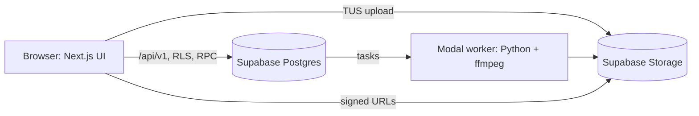
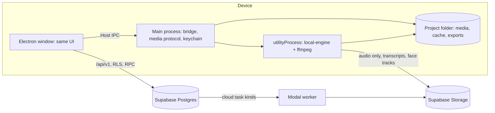

# Desktop app (Windows, macOS, Linux): spec for later

**Status: parked.** This spec is written down so the decisions are made once. It is not scheduled. Section
[When to start](#when-to-start) lists the signals that open it. Until then, the only work that lands is
[Phase D0](#phase-d0-desktop-ready-web-do-any-time), because it makes the web app better on its own.

While this spec is parked, `CLAUDE.md` still holds: "One system… There is no second runtime." Starting Phase D1
is the deliberate decision to change that rule, and `CLAUDE.md` and `ARCHITECTURE.md` are updated in the same PR.

## 1. Why a desktop app

The web app makes the user upload their long video before anything happens. A 45-minute 4K recording is
several GB: minutes of waiting, and it fails on bad connections. Everything after the upload is fast.

A desktop app removes the upload and moves rendering onto the user's machine:

| Gains | Does not change |
|---|---|
| No video upload; the editor opens the local file at once | AI (LLM, image/video/voice models, moderation) stays in the cloud; API keys never ship in an app |
| Local preview and export, with hardware encoders (NVENC, QSV, VAAPI, VideoToolbox) | Credits, plans and money stay on the server (`credit_hold` / `credit_settle` / `credit_refund`) |
| Lower Modal cost per user, so better margins | The document model, the editor, the assistant and the API are the same product |
| Source video never leaves the machine (privacy, a selling point) | Weak laptops are slower than Modal; budgets are per machine class (§9) |

## 2. Goals and non-goals

**Goals**

- One app for **Windows 10+ (x64, arm64), macOS 13+ (arm64, x64), Linux (x64; AppImage + .deb)**, built from one
  codebase, released together.
- Same account, same credits, same projects as the web. A project made on desktop opens on the web, and the
  other way round (§6).
- Local media: import, preview, cut, caption, reframe and export without uploading the video.
- The assistant works the same on both.
- The hard budgets in `CLAUDE.md` hold on the reference machines (§9).

**Non-goals (for this spec)**

- Offline AI, local LLMs, bring-your-own API keys.
- A native (Swift/WinUI/GTK) UI. One web UI everywhere.
- Mobile.
- Rewriting the backend. Supabase stays the backend (§11).

## 3. Decisions

### 3.1 Electron, not Tauri, not native

OpenCMO runs on Chromium + Node + ffmpeg: `clip-render` draws with Canvas 2D in the browser and with
`@napi-rs/canvas` in Node; `clip-export` is Node; `clip-motion` is Remotion (Chromium); `editor-parity` proves the
browser preview and the export draw the same pixels. Electron ships exactly one pinned Chromium and one Node on
every OS, so all of that runs unchanged and parity stays testable.

| | Electron | Tauri | Native per OS |
|---|---|---|---|
| Renderer on Windows | Pinned Chromium | WebView2 (Chromium, version varies) | n/a |
| Renderer on Linux | Pinned Chromium | **WebKitGTK**: slower canvas, no or partial WebCodecs, codecs depend on the distro | n/a |
| Node for `clip-export` | Built in | Sidecar binary needed | Rewrite |
| Remotion (`clip-motion`) | Works (Chromium) | Ships Chromium anyway | Rewrite |
| Parity guarantee | One engine to test | Three engines | Three codebases |
| Cost | ~150–200 MB installer, more RAM | Small | 3× the UI work |

Linux WebKitGTK alone rules out Tauri for a video editor.

### 3.2 Document in the cloud, media on the device

- The **clip document and its revisions stay in Supabase**, exactly as today. The assistant, the API, the MCP
  server, the web editor and other devices keep working on the same document.
- **Media lives in a local project folder** and is addressed by the same library paths the document already uses
  (`assets/master.mp4`). Signed URLs never enter `src` today (`apps/web/lib/editor/media.ts`), so only the resolver
  changes: on desktop a library path resolves to a local file through the app's media protocol.
- Small derived data (transcripts, face tracks, waveforms) is uploaded, because the assistant and the server read
  it. Audio only goes up for transcription: 45 minutes of 32 kbps Opus is ~11 MB, not GBs.
- Pixels the server needs (frame captures for the assistant) are produced by the client. `capture_frames` already
  waits for the browser (`apps/web/lib/agent/scope.ts`); the same path covers local media.

### 3.3 One Host interface, two implementations

Every place the UI touches I/O goes through a `Host` (§5): media resolution, import, tasks, saving files. The web
implementation is today's code (signed URLs, TUS, the `tasks` table). The desktop implementation talks over IPC
to the Electron main process. Feature code never checks "am I on desktop?". It asks the host what it can do.

### 3.4 Task routing: local where it is I/O and pixels, cloud where it is AI or money

| Task kind | Desktop runs it | Why |
|---|---|---|
| `probe_media` | **Local** (ffprobe) | Needs the file |
| `transcribe_media`, `transcribe_asset` | **Cloud**, audio-only upload | Model in the cloud; the audio is small |
| `prepare_full` / clip pipeline | **Local** ffmpeg steps + **cloud** LLM selection | The heavy part is ffmpeg on the file |
| `render_document` (export) | **Local** (`clip-export` in a utility process) | Pixels and encoders are local |
| `generate` (AI media) | **Cloud**; the result is downloaded into the project folder | Model and credits are server-side |
| `zip` | **Local** | Local files |
| `capture_page` (style skills) | **Cloud** | Untrusted pages stay off the user's machine and in the sandboxed function |
| Explainers (`clip-motion`) | Cloud in v1, local later (D6) | Remotion runs in Electron's Chromium, but it needs its own packaging |

`packages/contracts/task-kinds.json` gains a `runs` field (`cloud`, `local`, `both`) as the one source of truth,
and `check:contracts` keeps the Python worker, the web and the desktop engine in agreement.

### 3.5 The local engine is TypeScript + bundled ffmpeg, not the Python engine

Shipping Python + MediaPipe + yt-dlp in an installer for three OSes and two architectures (PyInstaller,
MediaPipe wheels only for Python 3.12) is the worst part of a desktop build. Instead:

- `packages/local-engine` (Node, runs in an Electron `utilityProcess`) implements the `local` task kinds by
  calling a bundled **ffmpeg/ffprobe** with the same arguments the Python engine uses. Rules 1–7 of the hard
  budgets apply as written (streaming subprocesses, `-ss` before `-i`, encoder detection by a one-frame test
  encode, `max_parallel`, demuxer allowlist for user media).
- **Face tracking** uses MediaPipe Tasks for Web (`@mediapipe/tasks-vision`, WASM/WebGL) in a hidden renderer,
  feeding the same face-track format `editor-core/src/face-track.ts` reads. Golden tests compare its tracks against
  the Python engine on the same fixtures before it ships.
- The ffmpeg command builders become a shared, tested spec (`packages/contracts/ffmpeg/*.json` fixtures:
  input → expected argv). Python and TypeScript both test against it, so the two engines don't drift.
- YouTube links stay a cloud feature (yt-dlp on the worker). Desktop is the upload-free path.

### 3.6 The shell loads the hosted app; the bridge is narrow

- v1 loads `https://app.opencmo.io` in a `BrowserWindow` (always the current UI, one deploy). A bundled UI
  (`packages/editor-ui`, §7) is the later step for offline-lite.
- Security: `contextIsolation: true`, `sandbox: true`, `nodeIntegration: false`, strict CSP, navigation and
  `window.open` allowed only to our origins (others open in the system browser), permission requests denied by
  default, the bridge exposed only when the top frame's origin is ours.
- **The bridge never takes a path from the page.** It exposes intents: "pick a video" (native dialog), "open the
  project folder", "run task X on media Y of project Z", "save export to…" (native dialog). The main process
  keeps the map from media id to path. An XSS on the web app must not turn into reading arbitrary local files.
- Local media is served through a custom protocol (`opencmo-media://<project>/<asset>`) that resolves only files
  registered in that project, supports range requests, and never lists directories.
- Auth: sign in through the system browser, return with a deep link (`opencmo://auth?code=…`, PKCE). The session
  lives in the OS keychain (`safeStorage`), not in a file.

### 3.7 Distribution

| OS | Format | Signing | Updates |
|---|---|---|---|
| macOS | `.dmg` (universal or per-arch) | Developer ID + notarization | `electron-updater` |
| Windows | NSIS `.exe` (x64, arm64) | Authenticode via Azure Trusted Signing (or an EV certificate), so SmartScreen does not block it | `electron-updater` |
| Linux | AppImage + `.deb` (Flatpak later) | GPG-signed release files | AppImage self-update; apt repository later |

Channels: `stable` and `beta`. The app checks a minimum supported version from the API and asks for an update
when the API contract moved, so old clients never write documents the server rejects.

**ffmpeg licence.** A build with libx264/libx265 is GPL. Decide before D2: ship an LGPL build that encodes
with hardware encoders + `libopenh264` (or `libsvtav1`), or accept GPL obligations for the bundled binary. Record
the answer here and in `THIRD_PARTY_NOTICES.md`.

## 4. Architecture

Today:



With desktop:



## 5. Host interface (`packages/host`)

```ts
export interface Host {
  kind: 'web' | 'desktop';
  can: { localMedia: boolean; localExport: boolean; revealInFolder: boolean; hardwareEncoders: string[] };
  media: {
    resolve(project: string, libraryPath: string): Promise<string>;      // URL the renderer can load
    importFiles(project: string, intent: 'video' | 'image' | 'audio'): Promise<ImportedMedia[]>; // native picker on desktop, TUS on web
  };
  tasks: {
    run(kind: TaskKind, spec: unknown): Promise<TaskHandle>;              // routes by task-kinds.json `runs`
    watch(handle: TaskHandle, onUpdate: (state: TaskState) => void): () => void;
    cancel(handle: TaskHandle): Promise<void>;
  };
  files: { saveExport(handle: TaskHandle): Promise<void> };              // download on web, save dialog on desktop
}
```

Rules: feature code receives a `Host` through React context and never imports Electron or Next.js APIs; `can.*`
decides what the UI shows, so the web never shows a button that only works on desktop; every method reaches a
terminal success, failure or cancellation, which the UI shows.

## 6. Data and sync

- **Project folder** (default `~/OpenCMO/<project-id>/`, user can move it): `media/` (imported originals by
  content hash, never modified), `cache/` (proxies, waveforms, thumbnails; safe to delete), `exports/`,
  `project.json` (id, owner, media map). The document itself is not in the folder.
- **Media manifest** (server, per project): for each library path, the content hash, size, duration and
  `location: device:<id> | cloud | both`. The server knows a file exists without having it.
- **Opening a desktop project on the web or another device:** media that is only on another device shows as
  "On <device name>" with one action, "Upload to open everywhere", which the user chooses. Nothing uploads
  silently.
- **Conflicts:** revisions stay the unit of change (today's model). Two devices editing at once get the same
  revision conflict handling the web already has with two tabs.
- **Moving or deleting files on disk:** the app checks hashes on open and offers "Locate file…" for anything
  missing. It never rewrites the document to drop media.

## 7. Repository structure at scale

The repo grows from one app into several apps, several services and a shared core. The layout below is the
target. Package **names do not change** (`@opencmo/clip-doc` stays `@opencmo/clip-doc`), so moving folders
changes no imports. Folders move in D0, one group per PR.

```
apps/
  web/                    Next.js: routes, API (app/api/v1), server-only code
  desktop/                Electron main + preload + packaging; no UI of its own
services/
  engine/                 Python worker on Modal (today packages/engine)
  page-capture/           Sandboxed capture function (style skills Track C)
packages/
  core/                   platform-free: no DOM, no Node APIs, no React
    clip-doc/  editor-core/  contracts/  skills/
  render/                 pixels
    clip-render/  clip-export/  clip-motion/  clip-three/  editor-parity/
  media/                  bundled data
    clip-assets/  clip-icons/  clip-media/
  app/                    the shared product UI and its I/O seam
    editor-ui/            editor React components (moved out of apps/web/components/editor)
    host/                 Host interface + the web implementation
    host-desktop/         desktop implementation (IPC client)
    api-client/           typed client for /api/v1 (web UI, desktop, MCP, CLI)
    local-engine/         Node implementation of `local` task kinds
supabase/                 migrations + pgTAP (unchanged)
tooling/                  shared tsconfig/eslint presets, repo scripts (today scripts/)
docs/
```

**Dependency rules** (enforced by a `dependency-cruiser` check in CI; a violation fails the build):

| Layer | May import | Must not import |
|---|---|---|
| `packages/core/*` | other `core` | DOM, Node built-ins, React, Next.js, Supabase, Electron |
| `packages/render/*` | `core`, `media` | React, Next.js, Supabase, Electron |
| `packages/app/editor-ui` | `core`, `render`, `media`, `host` (interface only), `api-client` | Next.js, Supabase clients, Electron, `host-desktop` |
| `packages/app/host-desktop`, `local-engine` | `core`, `render`, `contracts` | Next.js, React |
| `apps/web` | everything except `host-desktop`, `local-engine` | Electron |
| `apps/desktop` | `host-desktop`, `local-engine`, `core`, `render` | Next.js |

**Tooling at scale**

- npm workspaces with globs per group (`packages/core/*`, …) instead of the hand-written list in the root
  `package.json`.
- **Turborepo** for cached `typecheck`/`test`/`build` per package once CI passes ~15 minutes. Only affected
  packages run on a PR.
- CI jobs per layer, plus a desktop matrix (`windows-latest`, `macos-14`, `ubuntu-latest`) that builds the app,
  runs Playwright's Electron e2e, and runs `editor-parity` on each OS with per-OS golden tolerances (fonts come from
  `clip-media`, so differences come only from rasterization).
- `CODEOWNERS` by layer, so a change to `core` needs the owner of the contracts.

## 8. Phases

### Phase D0: desktop-ready web (do any time)

Each item stands on its own and improves the web app.

- [ ] D0.1 `packages/api-client`: one typed client for `/api/v1`. The 13 component files that call `fetch("/api/v1/…")`
  directly (10 of them in the editor) use it.
- [ ] D0.2 `packages/host` with the web implementation; media resolution, imports, tasks and export download in the
  editor go through it.
- [ ] D0.3 Move the editor UI to `packages/app/editor-ui` with no `next/*` and no Supabase imports. Add the dependency
  check.
- [ ] D0.4 `runs` in `task-kinds.json`; ffmpeg argv fixtures shared by Python tests.
- [ ] D0.5 Inventory every server path that reads media pixels or bytes (`serverMedia`, `readFrame`, export, the
  assistant). Each one gets a client-side route through the Host, or the reason it must stay server-side.
- [ ] D0.6 Folder moves into the §7 layout, one group per PR.

### Phase D1: shell

Electron app that loads the hosted app, with system-browser sign-in, deep links, keychain session, auto-update
(beta channel) and signed builds on all three OSes. Acceptance: install, sign in, open an existing web project,
update to a newer build. Nothing local yet.

### Phase D2: local media and preview

Import a local video with no upload. Proxies are generated locally, the media protocol serves the file, and the
audio-only upload produces the transcript. Acceptance: a 45-minute 4K file is editable with captions in under
2 minutes on the mid machine (§9), and its bytes never reach Storage (check the bucket).

### Phase D3: local export

`render_document` runs in a `utilityProcess` with hardware encoder detection. Export still snapshots the revision and
goes through `request_document_export` (plan limits stay server-side); a `runs: local` export task is claimed by
the device instead of the worker. Acceptance: the
exported frames match the web export of the same revision within parity thresholds; peak RSS < 2 GB.

### Phase D4: local clip pipeline

The long video → clips pipeline runs locally: local ffmpeg steps and face tracking, cloud selection. Acceptance:
"45-minute video → 5 clips" within the budget for each machine class, and face tracks within tolerance of the
Python engine on the shared fixtures.

### Phase D5: general availability

Stable channel, crash reporting (Sentry for Electron, no media or prompts in reports), a download page that
works for all three OSes, support docs. "Don't ship coming soon": the landing page mentions desktop only from
this phase on.

### Phase D6 (optional): local explainers and offline-lite

Remotion explainers render locally. The bundled UI opens and plays projects without a connection; edits queue
until online.

## 9. Budgets per machine class

The `CLAUDE.md` budgets were measured on Modal. Desktop keeps the RAM budget everywhere and states the time
budget per class:

| Class | Example | 45-min → 5 clips | Export 60 s 1080p |
|---|---|---|---|
| Low | 4-core x64 laptop, 8 GB, integrated GPU | < 8 min | < 90 s |
| Mid | Apple M1 / 8-core x64 with a recent iGPU | < 4 min | < 30 s |
| High | Apple M3 Pro / x64 with an NVIDIA GPU | < 3 min (the cloud budget) | < 15 s |

Peak RAM per job < 2 GB on every class. Each class has one machine in the release checklist, measured with the
OS equivalent of `/usr/bin/time -v`.

## 10. Risks

| Risk | Mitigation |
|---|---|
| Two engines drift (Python vs TypeScript) | Shared argv fixtures, face-track golden tests, one `task-kinds.json` |
| Codec gaps (HEVC on Windows without the extension, ProRes, VFR phone video) | Bundled ffmpeg decodes, never the OS; proxies are always H.264 |
| GPU driver variance | Encoder chosen by a one-frame test encode (rule 5), software fallback |
| Antivirus false positives and SmartScreen | Signed builds from day one, stable publisher identity |
| Linux fragmentation | AppImage as the supported format; `.deb` best effort |
| An XSS in the web app reaching local files | Intent-only bridge, origin checks, media protocol limited to registered files (§3.6) |
| Support load across 3 OSes | Beta channel first, crash reports, one reference machine per class |
| Disk usage from proxies | `cache/` size cap with LRU eviction and a "Free up space" action |

## 11. What about Rust?

- **Not for the backend.** The backend is Supabase (migrations, RPC, RLS); the Next.js routes are a thin layer. A
  Rust rewrite would make nothing faster and would lose the zod/TypeScript types shared with `editor-core`.
- **Not for speed of the pipeline.** Time is spent in ffmpeg, downloads and transcription; the orchestration
  around them is a small share of the measured 155 s.
- **Maybe for one thing later:** if the Node local engine shows a measured hot spot (frame analysis, audio
  envelopes), write that function in Rust as a Node addon (`napi-rs`). If shipping the engine as one static
  binary becomes worth it, revisit with measurements. MediaPipe has no Rust build, so face tracking would move
  to an ONNX model (`ort`) and need its own quality checks.

## When to start

Start D1 when at least two of these are true, and write the date and the numbers here:

- Upload is a top-3 reason for drop-off between sign-up and first clip (funnel data), or support hears it weekly.
- Modal render cost per paying user is over 15% of its revenue.
- Paying users ask for desktop or offline use repeatedly (count them).
- The web product hits its own targets (activation and retention), so desktop adds reach instead of hiding a web problem.

D0 needs no trigger.
